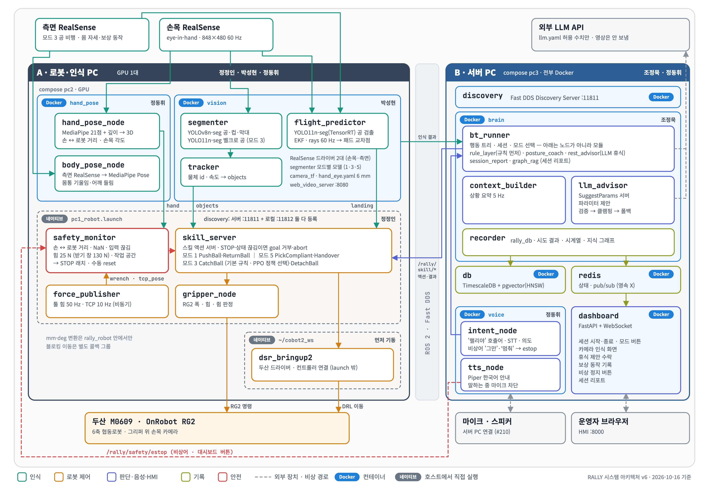
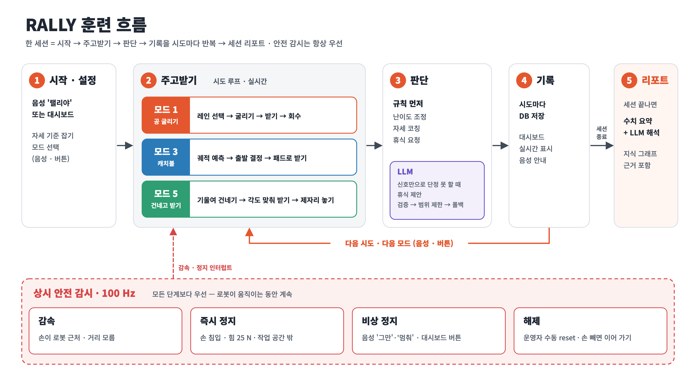
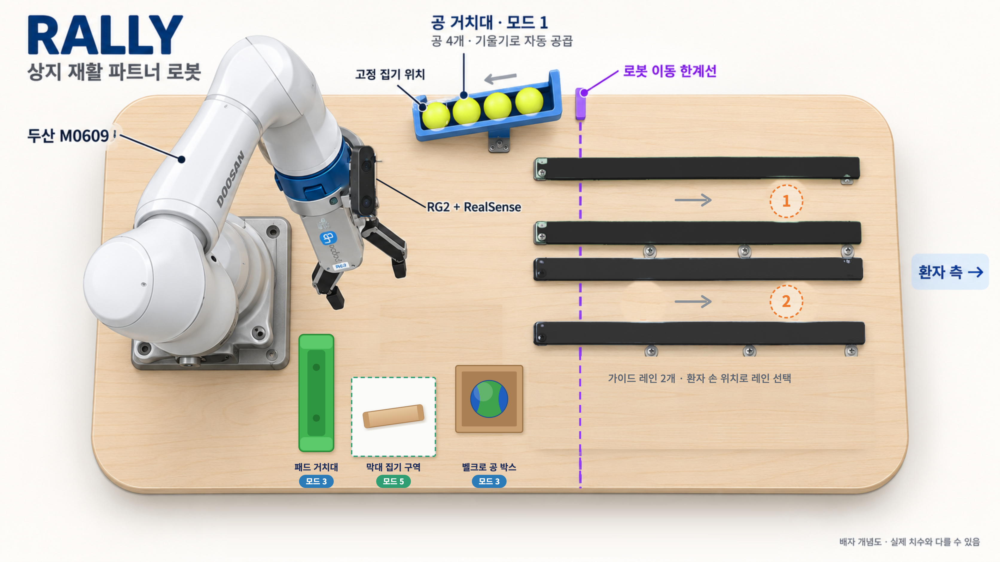

# RALLY — 테이블 건너편 재활 파트너 로봇

**R**ehabilitation **A**rm that **L**earns the ra**LLY** with you

두산 M0609 협동로봇이 공·패드·막대 같은 **물체를 통해서만** 환자와 주고받으며 상지 재활 훈련의
상대가 된다. 로봇은 공을 굴려 주고, 던진 공을 패드로 받고, 기울인 막대를 건네고 돌려받는다.
움직이는 공의 궤적을 예측하고, 손과 몸 자세를 읽고, 접촉을 힘으로 느끼고, 시도마다 기록해
다음 훈련을 조정한다. **로봇이 환자 쪽으로 밀거나 잡는 동작은 설계상 없다.**

ROS 2 Jazzy · 두산 M0609 + OnRobot RG2 · RealSense 2대 · 물리 PC 2대 (Docker + 네이티브).

> [두산로보틱스] 지능형 로보틱스 엔지니어 · 협동 프로젝트 (2026-10-06 ~ 10-16)

| 지표 | 결과 |
|---|---|
| 핸드아이 캘리브레이션 오차 | **10~42 mm → 평균 6 mm** (ArUco 터치 정답 기준, 최대 9 mm) |
| 모드 1 굴리기 레시피 예측 오차 | **RMSE 21 / 24 mm** (레인 1 / 2 · 목표 ≤ 30 mm) |
| 모드 3 궤적 예측 노드 처리 속도 | **18 → 60 Hz** (tf 조회 대기 제거) |
| 모드 3 출발 결정 시점 예측 오차 | **10.6 → 2.8 cm** (빠른 투구 bag 재생) |
| 모드 3 강화학습 정책 (시뮬 1만 투구) | 규칙 68.8 % → **PPO 71.4 %** (실로봇은 규칙 기본 · 정책 선택) |
| 음성 비상어 '그만'·'멈춰' 오탐 | **600 → 7 회/시간** · 인식 94 % (51/54) · 네트워크 없이 동작 |
| LLM 판단 응답 | 1.6 ~ 2.2 s (3 s 초과 시 규칙 폴백) |

---

## 제출 항목 대응표

| 요구 항목 | 어디에 |
|---|---|
| 시스템 설계 · 플로우차트 | [§1 시스템 설계](#1-시스템-설계) · [§2 플로우 차트](#2-플로우-차트) |
| 운영체제 환경 | [§3 운영체제 · 실행 환경](#3-운영체제--실행-환경) |
| 사용한 장비 목록 | [§4 사용 장비](#4-사용-장비) |
| 의존성 | [§5 의존성](#5-의존성) · `docker/<서비스>/requirements.txt` |
| 사용 설명 (launch 순서 · 스크립트) | [§6 설치](#6-설치) · [§7 실행](#7-실행) · [`docs/DEMO_CHECKLIST.md`](docs/DEMO_CHECKLIST.md) |
| ROS 2 패키지 | [`ros2_ws/src/`](ros2_ws/src/) — colcon 패키지 **8개** |
| 인터페이스 명세 | [`docs/INTERFACES.md`](docs/INTERFACES.md) — msg 8 · srv 6 · action 9 |
| 설계 근거 (BRD · SRD) | [`docs/RALLY_기획서.md`](docs/RALLY_기획서.md) |

> [!IMPORTANT]
> **모델 파일은 저장소에 없다.** 비전·음성 가중치는 `models/` 아래에 두지만 git 에서 제외했다
> (용량·라이선스). 받아서 넣지 않으면 컨테이너는 뜨는데 **물체가 안 보이고 비상어가 꺼진다.**
> 넣을 파일 목록은 [§6-②](#step2).

> 규약은 [`CLAUDE.md`](CLAUDE.md), 인터페이스는 [`docs/INTERFACES.md`](docs/INTERFACES.md) 에 있다.
> **숫자의 정본은 `ros2_ws/src/rally_bringup/config/*.yaml`** 이다 (`skills.yaml` · `safety.yaml` · `table.yaml` · `llm.yaml`).

---

## 목차

1. [시스템 설계](#1-시스템-설계)
2. [플로우 차트](#2-플로우-차트)
3. [운영체제 · 실행 환경](#3-운영체제--실행-환경)
4. [사용 장비](#4-사용-장비)
5. [의존성](#5-의존성)
6. [설치](#6-설치)
7. [실행](#7-실행)
8. [잘 도는지 확인](#8-잘-도는지-확인)
9. [안 될 때](#9-안-될-때)
10. [저장소 구조](#10-저장소-구조)
11. [팀](#11-팀)

---

## 1. 시스템 설계

### 1-1. 전체 구조 — PC 2대, 컨테이너와 네이티브

GPU 가 한 대뿐이고 카메라 → 인식 → 로봇 경로는 지연에 민감하다. 그래서 **이 경로를 한 PC 안에
모으고**, 판단·기록·음성·대시보드는 와이파이 너머 서버 PC 로 뺀다.

- **A · 로봇·인식 PC** — 추론은 Docker(`compose --profile pc2`), 로봇 제어는 호스트 네이티브(`pc1_robot.launch.py`).
  두산 드라이버(`dsr_bringup2`)는 그보다 먼저 따로 띄운다.
- **B · 서버 PC** — 전부 Docker(`compose --profile pc3`): discovery · brain · db · redis · voice · dashboard.



`pc1` / `pc2` / `pc3` 은 **역할 이름**(launch · compose 프로필)이지 PC 번호가 아니다. 로봇·인식 PC 에서
`pc1`(네이티브)과 `pc2`(컨테이너)를 같이 띄운다.

### 1-2. 노드 구성

| 노드 | 위치 | 패키지 | 하는 일 | **하지 않는 일** |
|---|---|---|---|---|
| **`skill_server`** | A · 네이티브 | `rally_robot` | 스킬 액션 8종 실행 — **로봇 명령의 유일한 발신자** | 다음 행동 결정 |
| **`safety_monitor`** | A · 네이티브 | `rally_robot` | 100 Hz 안전 감시 · STOP 래치 | 로봇 이동 |
| `force_publisher` · `gripper_node` | A · 네이티브 | `rally_robot` | 툴 힘 50 Hz · TCP 10 Hz · RG2 폭·힘 | |
| `segmenter` → `tracker` | A · Docker `vision` | `rally_vision` | YOLO-Seg 마스크 → 물체 3D · 기울기 → `objects` | 로봇 명령 |
| `flight_predictor` | A · Docker `vision` | `rally_vision` | 두 카메라로 공 궤적 예측 → 패드 교차점 | 로봇 명령 |
| `camera_tf` | A · Docker `vision` | `rally_vision` | `hand_eye.yaml` → `base_link → camera_link` tf | |
| `hand_pose` · `body_pose` | A · Docker `hand_pose` | `rally_human` | 손 21점 3D · 손 ↔ 로봇 거리 · 손목 각도 / 몸통 기울임·어깨 들림 | |
| **`bt_runner`** | B · Docker `brain` | `rally_brain` | 행동 트리 · 세션 · 모드 선택 · 규칙 판단 · 휴식 판단 · 세션 리포트 | **로봇 직접 구동** — 스킬 액션으로만 |
| `context_builder` | B · Docker `brain` | `rally_brain` | 인식 결과 → 상황 요약 5 Hz | |
| `llm_advisor` | B · Docker `brain` | `rally_brain` | `SuggestParams` — 파라미터 제안 (검증 → 클램핑 → 폴백) | **로봇 명령** |
| `recorder` | B · Docker `brain` | `rally_db` | 시도 결과 · 시계열 · 지식 그래프 관계 기록 | |
| `intent_node` · `tts_node` | B · Docker `voice` | `rally_voice` | '랠리야' 호출어 · STT · 의도 · **비상어 → estop** / 한국어 TTS | |
| `dashboard` | B · Docker | `dashboard/` | FastAPI + WebSocket HMI :8000 | |

> **로봇을 움직이는 길은 `skill_server` 하나다.** brain 은 스킬 액션 goal 만 보내고, LLM 결과는
> pydantic 스키마 검증 → `skills.yaml` 범위 클램핑 → 규칙 폴백을 거쳐야 goal 이 된다.
> `bt_runner` 안의 `rule_layer` · `rest_advisor` · `posture_coach` · `session_report` · `graph_rag` 는
> 별도 노드가 아니라 **모듈**이다.

### 1-3. 인터페이스

토픽에 `std_msgs/String` + JSON 을 쓰지 않는다. 전부 `rally_interfaces` 전용 타입이다
(msg 8 · srv 6 · action 9). 전체 표는 [`docs/INTERFACES.md`](docs/INTERFACES.md).

**주요 토픽**

| 토픽 | 타입 | 방향 |
|---|---|---|
| `/camera/color/*` · `/side/side/color/*` | `sensor_msgs/Image` | RealSense → 인식 |
| `/rally/perception/objects` · `/objects/image_axis` | `TrackedObjectArray` · `PoseArray` | vision → 로봇·brain |
| `/rally/perception/landing` | `PointStamped` | flight_predictor → skill_server (모드 3) |
| `/rally/perception/hand` · `/body` | `HandState` · `BodyPose` | hand_pose → 안전·brain |
| `/rally/robot/wrench` · `/tcp_pose` | `WrenchStamped` · `PoseStamped` | force_publisher → 안전 |
| `/rally/safety/status` | `SafetyStatus` (100 Hz) | safety_monitor → 전원 |
| `/rally/safety/estop` | `Bool` (TransientLocal) | 음성·대시보드 → safety_monitor |
| `/rally/safety/contact_expected` · `/patient_contact` | `Bool` (5 Hz 하트비트) | skill_server → safety_monitor |
| `/rally/voice/intent` · `/speaking` | `VoiceIntent` · `Bool` | voice → brain·안전 |
| `/rally/brain/context` · `/state` | `SceneContext` · `String` | brain → 대시보드·DB |

**스킬 액션 8종** — `/rally/skill/{push_ball, return_ball, catch_ball, detach_ball, move_target, pick_compliant, handover, resist_push}` + 세션 `/rally/session/run`

**반드시 지킬 규약 5개**

1. **센서·관절·힘 스트림은 `qos_profile_sensor_data`(BEST_EFFORT), 안전·결과·명령은 RELIABLE.**
   TransientLocal 은 `/rally/safety/estop` · `/rally/voice/speaking` 둘뿐이다 (늦게 켜진 노드도 현재 상태를 알아야 함).
2. **좌표는 미터·라디안, 프레임은 `base_link`.** 두산 DRL 의 mm·deg 변환은 `rally_robot` 안에서만 한다.
3. **블로킹 호출(`movel`·`mwait`·추론·LLM)은 별도 콜백 그룹에서.** 안전 감시 콜백을 막으면 안 된다.
4. **타임스탬프는 센서 원본 `header.stamp` 를 그대로 넘긴다** (지연 측정 · 모드 3 궤적 맞춤의 근거).
5. **안전 상태를 못 받으면 움직이지 않는다.** `skill_server` 는 `/rally/safety/status` 가 끊기면 goal 을 거부하고 실행 중 액션을 멈춘다.

---

## 2. 플로우 차트

### 2-1. 한 세션의 흐름

시작 → 주고받기 → 판단 → 기록을 **시도마다 반복**하고, 세션이 끝나면 리포트를 만든다.
**안전 감시는 모든 단계보다 우선**한다.



### 2-2. 훈련 모드

| 모드 | 이름 | 재활 목적 | 흐름 | 핵심 스킬 |
|---|---|---|---|---|
| **1** | 공 굴리기 | 팔 뻗기 | 손 위치로 레인 선택 → 거치대 공 집기 → 레인 입구에 놓기 → 굴리기 → 받기 관측 → 회수 | `PushBall` · `ReturnBall` |
| **3** | 캐치볼 | 던지기 · 협응 | 패드 집기 → 대기 자세 → 투구 감지 → 궤적 예측 → 출발 결정 → 패드로 받기 | `CatchBall` · `DetachBall` |
| **5** | 건네고 받기 | 손목 회전 · 쥐기 | 막대 집기 → ±45° 기울여 건네기(당기면 놓음) → 기울기 맞춰 받기 → 제자리 내려놓기 | `PickCompliant` · `Handover` |

- 모드는 **음성("랠리야 → 공 굴리기 하자")이나 대시보드 버튼**으로 고른다. 세션 종료도 음성·버튼.
- 모드 7(저항 밀기)은 구현돼 있지만 시연에서 뺐다 (`ResistPush` — 로봇은 버티다 물러날 뿐 환자 쪽으로 밀지 않는다).

### 2-3. 판단 — 규칙 먼저, LLM 은 보조

| 층 | 언제 | 무엇을 |
|---|---|---|
| **규칙** (`rule_layer`) | 매 시도 | 난이도 조정 · 자세 코칭(보상 동작 연속 2회 → 음성) · 휴식 요청 |
| **LLM** (`rest_advisor`) | 신호만으로 단정 못 할 때 | 휴식 제안 — 보상 동작·성공률·시도 시간 신호가 쌓이면 판단, 대시보드에서 수락 |
| **LLM** (`llm_advisor`) | 파라미터 제안 요청 | 허용 범위(`skills.yaml llm_tunable`) 안의 값만 · 3 s 초과면 규칙 폴백 |
| **세션 리포트** | 세션 끝 | 수치 요약 + 지식 그래프(비슷한 과거 시도, pgvector) 근거 → LLM 해석 |

> 외부 LLM API 에는 `llm.yaml` 화이트리스트의 **수치 특징값만** 보낸다. 영상은 PC 밖으로 나가지 않고 DB 에도 저장하지 않는다.

### 2-4. 안전 — 4단계

| 단계 | 조건 | 해제 |
|---|---|---|
| **감속** | 손이 로봇 근처 · 손은 보이는데 거리 모름(NaN) · 입력 끊김 | 자동 |
| **즉시 정지** | 손 침입(로봇 20 cm · 중앙선 너머) · 합력 25 N(받기 창 130 N) · 작업 공간 밖 | 손을 빼면 이어 감 (모드 1·5) |
| **비상 정지** | 음성 '그만'·'멈춰'(호출어 없이) · 대시보드 버튼 · 하드웨어 버튼 | **운영자 수동 reset** |
| **세션 종료** | 중앙선 너머 30 cm 넘게 깊이 침입 | 새 세션 |

환자가 물체를 잡는 구간(`patient_contact`)에서는 로봇이 환자 쪽으로 움직이지 않는 대신 손 근접 정지를 감속으로 낮춘다.
임계값은 코드가 아니라 [`safety.yaml`](ros2_ws/src/rally_bringup/config/safety.yaml) 에만 있다.

---

## 3. 운영체제 · 실행 환경

| 항목 | 값 | 비고 |
|---|---|---|
| OS | **Ubuntu 24.04 LTS** | 두 PC 모두 |
| 미들웨어 | **ROS 2 Jazzy** (Python **3.12**) | 네이티브는 `/opt/ros/jazzy`, 컨테이너는 `ros:jazzy-ros-base` |
| 컨테이너 | Docker + Compose · NVIDIA Container Toolkit | 비전 런타임 `nvidia/cuda:12.6.0-runtime-ubuntu24.04` |
| 두산 SDK | `dsr_common2` · `m0609_rg2_bringup` | `~/cobot2_ws` (이 저장소 밖) |
| DDS | Fast DDS **Discovery Server** | 서버 PC `:11811` + 로봇 PC 로컬 `:11812` 동시 등록 |
| `ROS_DOMAIN_ID` | **10** (두 PC 동일) | `docker/.env` |
| 네트워크 | 와이파이 (같은 AP) | 서버 PC ↔ 로봇 PC ping 37 ~ 114 ms |
| DB | PostgreSQL 16 + TimescaleDB + pgvector(HNSW) · Redis | 서버 PC 컨테이너 |
| 빌드 | `colcon build --symlink-install` (네이티브) · `--merge-install` (이미지) | |

> ⚠ **네이티브 터미널은 매번 `source scripts/env_robot_pc.sh` 먼저.** Discovery Server 클라이언트 설정이
> 없으면 노드는 다 사는데 컨테이너·서버 PC 와 서로 안 보인다.

---

## 4. 사용 장비

### 4-1. 로봇 · 엔드이펙터

| 항목 | 값 |
|---|---|
| 로봇 | **두산로보틱스 M0609** · 6축 협동로봇 (가반 6 kg · 도달 900 mm) |
| 그리퍼 | **OnRobot RG2** (Modbus TCP) · 물체별 힘 3 ~ 40 N (`skills.yaml gripper`) |
| 툴 | TCP 오프셋 228 mm · 모드 3 벨크로 패드(3D 프린팅 손잡이) |
| 제어 | DRL `amovel` / `amovej` · 순응 제어(`task_compliance_ctrl`) · 힘 조건 |

### 4-2. 센서

| 장치 | 위치 | 역할 |
|---|---|---|
| **손목 RealSense** | 그리퍼 위 (eye-in-hand) · 848×480 · 60 Hz | 물체 3D · 손 3D · 정지 위치 · 모드 3 공 |
| **측면 RealSense** | 테이블 옆 고정 · 60 Hz · 노출 고정 | 모드 3 공 비행 · 몸 자세 · 보상 동작 |
| 마이크 · 스피커 | 서버 PC (USB-C 이어셋 · 내장 스피커) | 호출어 · 비상어 · 한국어 TTS |
| 하드웨어 비상정지 | 두산 컨트롤러 | 운영자 옆 |

### 4-3. 작업대



| 설비 | 사양 |
|---|---|
| 가이드 레인 | **2개** · 검정 레일 · 레인 간격 147.4 mm · 입구 x ≈ 433 mm |
| 공 거치대 (모드 1) | 기울어진 레일 · 테니스공 4개 · 위쪽 끝 (462.5, 289.8) mm |
| 패드 거치대 (모드 3) | 3D 프린팅 · 손잡이 자리 (236.9, −139.8) mm |
| 벨크로 공 박스 (모드 3) | 놓는 점 (595.0, −152.7) mm |
| 막대 집기 구역 (모드 5) | 흰 종이 · 위치는 비전으로 찾음 |
| 로봇 이동 한계선 | **x = 568 mm** (보라색 테이프 · 로봇은 넘지 않음) |
| 테이블 상판 | z = 14.4 mm (로봇 베이스 기준) |

좌표는 모두 로봇 베이스 기준 실측이다 (`table.yaml` · `skills.yaml`). 치수가 들어간 평면도는
[`docs/images/table_layout_v4.png`](docs/images/table_layout_v4.png).

### 4-4. 컴퓨팅

| PC | 역할 | 사양 |
|---|---|---|
| **A · 로봇·인식 PC** | 두산 드라이버 · 로봇 노드(네이티브) · 비전·손 추론(Docker) | RTX 4060 8 GB · 16코어 · 유선으로 로봇 컨트롤러 |
| **B · 서버 PC** | discovery · brain · DB · Redis · 음성 · 대시보드(전부 Docker) | 노트북 · 와이파이 |

---

## 5. 의존성

ROS 패키지는 `package.xml`, 파이썬 패키지는 서비스별 `docker/<서비스>/requirements.txt` 에 있다.

| 서비스 | 주요 의존성 |
|---|---|
| `vision` | `ultralytics` (YOLOv8n-seg · YOLO11n-seg) · `tensorrt` · `torch` · `pyrealsense2` · `filterpy` · `scipy` · `opencv<4.12` · `numpy<2` |
| `hand_pose` | `mediapipe==1.1.0` (Hand / Pose Landmarker) · `opencv-contrib-python<4.12` · `numpy<2` |
| `brain` | `openai` · `pydantic` · `sqlalchemy` · `psycopg` · `pgvector` · `redis` · `rdflib` (온톨로지 JSON-LD) · `py_trees` |
| `voice` | `faster-whisper` · `silero-vad` · `piper-tts` · `onnxruntime` · `scikit-learn==1.9.1` (비상어 판별기) · `sounddevice` |
| `dashboard` | FastAPI · uvicorn · WebSocket |
| 네이티브 (`rally_robot`) | `rclpy` · `numpy` · `scipy` · `PyYAML` · `DSR_ROBOT2` (두산 SDK) · 선택 `onnxruntime` (모드 3 정책) |

> ⚠ `numpy<2` · `opencv<4.12` 고정은 `cv_bridge`(apt, numpy 1.26 기준)와의 충돌 때문이다. 풀면 이미지 변환에서 죽는다.

---

## 6. 설치

### ① 클론 · 네이티브 빌드 (로봇·인식 PC)

```bash
git clone <저장소 URL> ~/rally && cd ~/rally
source /opt/ros/jazzy/setup.bash
cd ros2_ws && colcon build --symlink-install --packages-up-to rally_bringup rally_robot && cd ..
```

두산 SDK(`dsr_common2`, `m0609_rg2_bringup`)는 `~/cobot2_ws` 에 따로 빌드돼 있어야 한다.

<a id="step2"></a>

### ② 모델 파일 넣기 — 안 넣으면 **에러 없이** 물체가 안 보인다

`models/` 는 git 에서 제외했다. 팀 드라이브에서 받아 아래 자리에 둔다.

| PC | 경로 (`~/rally/models/`) | 쓰는 곳 |
|---|---|---|
| 로봇·인식 | `yolov8n-seg_ball.pt` | 모드 1 테니스공 |
| 로봇·인식 | `yolov8n-seg_cupstick.pt` (손에 든 막대 학습본) | 모드 5 막대 |
| 로봇·인식 | `velcro_ball_yolo11n-seg_1024_rot_v2.(engine\|pt)` · `mode3_side_calib.json` | 모드 3 벨크로 공 · 측면 카메라 |
| 로봇·인식 | `policy_stage1.onnx` (+ `.onnx.json`) — 선택 | 모드 3 PPO 정책 (`decide_mode: policy` 일 때만) |
| 서버 | `kws/emergency_kws.joblib` | 비상어 '그만'·'멈춰' · 호출어 '랠리야' |
| 서버 | `piper/ko_KR-kss-medium.onnx` (+ `.json`) | 한국어 TTS |

> 막대 모델이 옛 파일(흰 배경 전용)이면 손에 든 막대를 못 봐서 모드 5 받기가 **기울기 맞춤 없이 힘으로만** 동작한다.
> 비상어 모델이 없으면 voice 로그에 `상시 감지 꺼짐` — **시연 전 반드시 확인**.

### ③ 환경 변수 (서버 PC)

```bash
cp docker/.env.example docker/.env
# PC3_IP=<서버 PC IP>  ROS_DOMAIN_ID=10  OPENAI_API_KEY=...  ROBOT_VIDEO_URL=http://<로봇 PC IP>:8080
```

`OPENAI_API_KEY` 가 없어도 동작한다 — LLM 판단은 규칙 폴백, 세션 리포트는 수치 요약만 나온다.
비밀값은 `docker/.env` 에만 둔다 (`.gitignore` 에 있다).

### ④ DB 스키마 (서버 PC, 처음 한 번)

`db` 컨테이너가 처음 뜰 때 `schema.sql` 을 건다. 이후 추가 마이그레이션은 `schema_00N_*.sql` 로 적용한다:

```bash
docker exec -i docker-db-1 psql -U rally -d rally < ros2_ws/src/rally_db/rally_db/schema_004_graph.sql
docker exec docker-db-1 psql -U rally -d rally -c "\dt kg_*"     # kg_edge · kg_node
```

---

## 7. 실행

**순서가 중요하다** — discovery 와 안전 감시가 먼저 떠야 로봇 노드가 움직인다.
리허설에서 다듬은 전체 순서는 [`docs/DEMO_CHECKLIST.md`](docs/DEMO_CHECKLIST.md).

```bash
# ① 서버 PC — 기반
cd ~/rally/docker && docker compose --profile pc3 up -d discovery db redis
```

```bash
# ② 로봇·인식 PC 터미널 1 — 두산 드라이버
cd ~/rally && source scripts/env_robot_pc.sh
ros2 launch m0609_rg2_bringup bringup.launch.py mode:=real host:=192.168.1.100
```

```bash
# ③ 로봇·인식 PC 터미널 2 — 안전 감시 → (발행 확인) → 힘 · 그리퍼 · 스킬 서버
cd ~/rally && source scripts/env_robot_pc.sh
ros2 launch rally_bringup pc1_robot.launch.py hand_stop:=slow
```

```bash
# ④ 로봇·인식 PC 터미널 3 — 추론 컨테이너 (vision · hand_pose)
cd ~/rally/docker && docker compose --profile pc2 up -d --build
```

```bash
# ⑤ 서버 PC — brain · 대시보드 · 음성
cd ~/rally/docker && docker compose --profile pc3 up -d --build brain dashboard voice
# 대시보드: http://<서버 PC IP>:8000
```

```bash
# ⑥ 세션 시작 — 모드를 비우면 '모드 선택 대기' (음성·대시보드로 고름)
ros2 action send_goal /rally/session/run rally_interfaces/action/RunSession \
  "{patient_id: demo, modes: [], trials_per_mode: 0}" --feedback
```

> `pc1_robot.launch.py` 는 `safety_monitor` 를 먼저 띄우고 `/rally/safety/status` 가 실제로 나오는지
> `wait_ready` 로 확인한 **뒤에만** 로봇 노드를 켠다. 확인에 실패하면 로봇 노드를 켜지 않고 끝난다.

### 로봇 없이 시험

| 방법 | 무엇 |
|---|---|
| `ros2 run rally_robot skill_server --fake` | 가짜 DSR — 이동 시간 · 접촉 힘 · 당김을 흉내 (`safety_monitor` 와 같이) |
| `scripts/sim_robot.sh up` | 두산 에뮬레이터 + RViz (`ROS_DOMAIN_ID=77`, x86 리눅스) |
| `scripts/robot.sh …` | 로봇 PC 혼자 시험하는 로컬 모드 — [`docs/ROBOT_RUN.md`](docs/ROBOT_RUN.md) |

### 자주 쓰는 스크립트

| 스크립트 | 무엇 |
|---|---|
| `scripts/env_robot_pc.sh` | 네이티브 터미널 DDS 설정 (매번 먼저) |
| `scripts/estop.sh` · `estop.sh reset` | 소프트 비상정지 · 해제 |
| `scripts/robot.sh` | 로봇 PC 단독 실행 · 상태 확인 · 정리 |
| `scripts/push_recipe.py` | 모드 1 레시피 실측 (밀기 속도 → 정지 거리) |
| `scripts/mode3_catch_loop.py` | 모드 3 받기 반복 시험 |
| `scripts/mode5_cycle.py` | 모드 5 집기 → 건네기 → 받기 반복 |
| `scripts/fit_hand_eye.py` · `verify_calibration.py` | 핸드아이 재맞춤 · 검증 (ArUco 터치) |
| `scripts/kws/` | 비상어 녹음 · 학습 · 실시간 측정 |
| `scripts/print_pose.py` | 현재 posx / posj 출력 (교시값 기입용) |

### 테스트

```bash
cd ros2_ws && colcon test --packages-select rally_robot rally_brain rally_vision rally_human rally_voice rally_db
colcon test-result --verbose
```

CI(`.github/workflows/`)가 PR 마다 `colcon build/test` 와 이미지 빌드를 돈다.

---

## 8. 잘 도는지 확인

```bash
source scripts/env_robot_pc.sh
ros2 run rally_bringup wait_ready --group session --once    # 세션 시작에 필요한 것 전부
ros2 topic echo /rally/safety/status --once                 # level 0 = NORMAL
ros2 topic hz /camera/color/image_raw                       # ≈ 60 (손목)
ros2 topic hz /side/side/color/image_raw                    # ≈ 60 (측면)
```

정상이면 대시보드 오른쪽 위에 **실시간 연결됨**, 안전 띠 **NORMAL**, brain 로그에 `세션 시작 조건 충족` 이 나온다.

---

## 9. 안 될 때

| 증상 | 원인 |
|---|---|
| 노드는 다 사는데 서로 안 보인다 | 네이티브 터미널에서 `source scripts/env_robot_pc.sh` 를 안 했다 · `ROS_DOMAIN_ID` 불일치 |
| 컨테이너 ↔ 네이티브 메시지가 오류 없이 사라진다 | root 소유 `/dev/shm/fastrtps_*` — `sudo rm /dev/shm/fastrtps_*` 한 번 (`docker/README.md`) |
| 스킬 goal 이 전부 거부된다 | `safety_monitor` 가 안 떴거나 상태가 끊김 (`safety_status_stale`) · STOP 래치 → `scripts/estop.sh reset` |
| STOP `wrench_missing` · 툴 힘이 0 | 로봇이 특이점 근처 자세 — 관측 자세로: `ros2 service call /rally/robot/go_observe_pose std_srvs/srv/Trigger` |
| 비전이 물체를 못 찾는다 | `models/` 파일 누락 · 막대 모델이 옛 파일 — [§6-②](#step2) |
| 비상어에 반응이 없다 | voice 로그 `상시 감지 꺼짐` → 비상어 모델 누락 · 연습용 `docker-compose.kws-off.yml` 로 띄움 |
| TTS 가 `done: true` 인데 안 들린다 | 서버 PC 데스크톱 오디오(PipeWire) 출력 장치 — `docs/DEMO_CHECKLIST.md` 0절 |
| 대시보드 카메라 칸이 없다 | 서버 PC `.env` 의 `ROBOT_VIDEO_URL` 누락 → `docker compose --profile pc3 up -d --force-recreate dashboard` |

더 많은 증상은 [`docs/DEMO_CHECKLIST.md`](docs/DEMO_CHECKLIST.md) 7절.

---

## 10. 저장소 구조

| 경로 | 담당 | 무엇 |
|---|---|---|
| `ros2_ws/src/rally_interfaces/` | 공용 | msg 8 · srv 6 · action 9 — 바꾸면 PR + `docs/INTERFACES.md` 동시 수정 |
| `ros2_ws/src/rally_bringup/` | 공용 | launch 5종 · `config/*.yaml` (숫자의 정본) |
| `ros2_ws/src/rally_robot/` | 정정인 | 스킬 서버 · 안전 감시 · 힘 · 그리퍼 · 스킬 8종 |
| `ros2_ws/src/rally_vision/` | 박성현 | 분할 · 추적 · 궤적 예측 · 카메라 tf · 학습 기록 |
| `ros2_ws/src/rally_human/` | 정동휘 | 손 · 몸 자세 |
| `ros2_ws/src/rally_voice/` | 정동휘 | 호출어 · 비상어 · STT · 의도 · TTS |
| `ros2_ws/src/rally_brain/` | 조정묵 | 행동 트리 · 규칙 · LLM · 온톨로지 · Graph RAG · 세션 리포트 |
| `ros2_ws/src/rally_db/` | 조정묵 | 기록 · 스키마 마이그레이션 · 임베딩 |
| `docker/` | 조정묵 | compose(`pc2` / `pc3`) · 서비스별 Dockerfile — 고치기 전에 `docker/README.md` |
| `dashboard/` | 조정묵 | FastAPI + WebSocket HMI |
| `scripts/` | — | 실행 · 실측 · 캘리브레이션 · 학습 스크립트 |
| `docs/` | — | 기획서 · 인터페이스 · 시연 체크리스트 · 모드 3 실측 기록 · 그림 |
| `todo/` | — | 담당별 할 일 · 막힌 것 |

**git 에 없는 것**

| | 어떻게 얻나 |
|---|---|
| `models/` — 비전 · 음성 · 정책 가중치 | 팀 드라이브 — [§6-②](#step2) |
| `data/` — 데이터셋 · bag · 녹음 | 실측 스크립트가 만든다 (외부 전송 없음) |
| `docker/.env` · `rally_voice/resource/.env` | `.env.example` 복사 후 작성 |
| `build/` · `install/` · `log/` | `colcon build` 산출물 |

### 하지 말 것

- ❌ **`safety.yaml` 밖에서 안전 임계값 바꾸기** — 바꾸면 커밋 메시지에 이유(실측)를 적는다
- ❌ **안전 STOP 상태에서 로봇을 움직이는 코드**
- ❌ **LLM 출력을 로봇에 바로 보내기** — 검증 → 클램핑 → 폴백을 거친다
- ❌ **영상 원본을 외부 API · DB 로 보내기**
- ❌ 모드 7 에서 로봇이 환자 쪽으로 능동 이동하는 코드
- ❌ 코드에 숫자 상수 박기 — `config/*.yaml` 에서 읽는다
- ❌ `main` 직접 push — `feat/<패키지>/<주제>` → PR

---

## 11. 팀

| 담당 | 영역 | 패키지 |
|---|---|---|
| **정정인** (PM) | 로봇 제어 · 안전 감시 · 모드 1 | `rally_robot` |
| **박성현** | 비전 · 핸드아이 · 모드 3 | `rally_vision` |
| **정동휘** | 사람 인식 · 음성 · 모드 5 | `rally_human` · `rally_voice` |
| **조정묵** | 지능 · 인프라 · HMI 대시보드 · 세션 전체 | `rally_brain` · `rally_db` · `rally_bringup` · `rally_interfaces` · `docker/` · `dashboard/` |

**공용 파일(`rally_interfaces` · `config/*.yaml` · `docker/`)을 바꿨으면 반드시 공유한다** — 다른 팀원이 다시 빌드해야 한다.

---

## 문서

| 문서 | 무엇 |
|---|---|
| [`CLAUDE.md`](CLAUDE.md) | 코딩 규약 · 절대 규칙 (에이전트·사람 공통) |
| [`docs/RALLY_기획서.md`](docs/RALLY_기획서.md) | BRD · SRD · 결정 근거 · 일정 |
| [`docs/INTERFACES.md`](docs/INTERFACES.md) | 토픽 · 서비스 · 액션 · tf · QoS 명세 |
| [`docs/INTELLIGENCE.md`](docs/INTELLIGENCE.md) | 판단 구조 — 규칙 · LLM · 지식 그래프 |
| [`docs/DEMO_CHECKLIST.md`](docs/DEMO_CHECKLIST.md) | 시연 기동 순서 · 안전 점검 · 문제 해결 |
| [`docs/ROBOT_RUN.md`](docs/ROBOT_RUN.md) | 로봇 PC 단독 실행 |
| [`docs/mode3/`](docs/mode3/) | 모드 3 계획 · 실측 기록 · 강화학습 정책 적용 |
