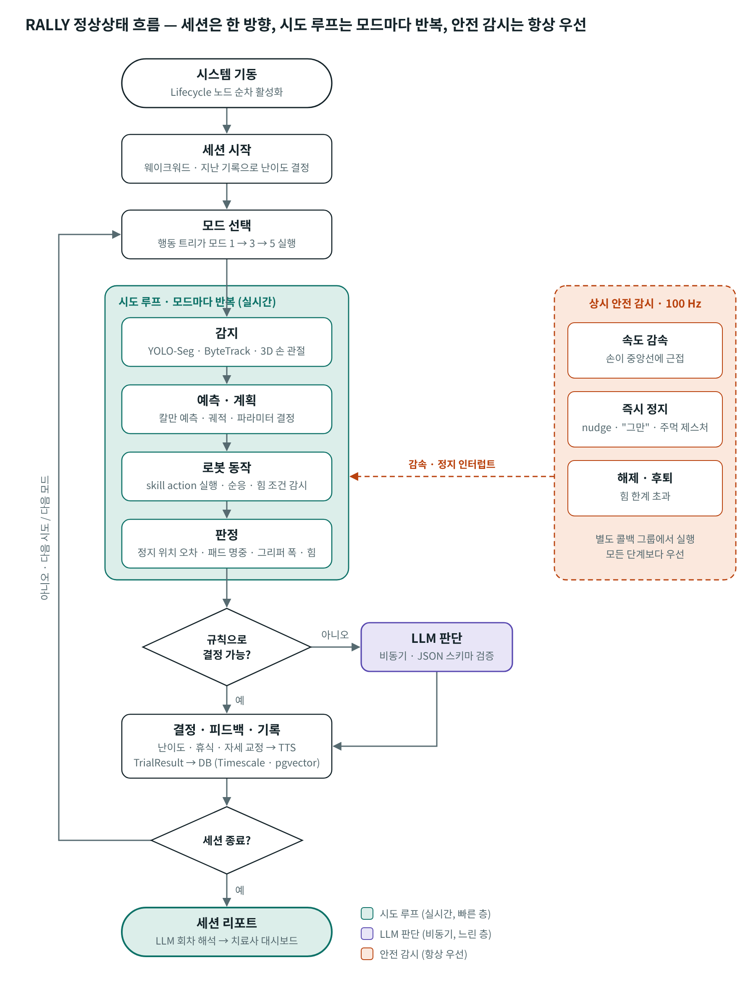
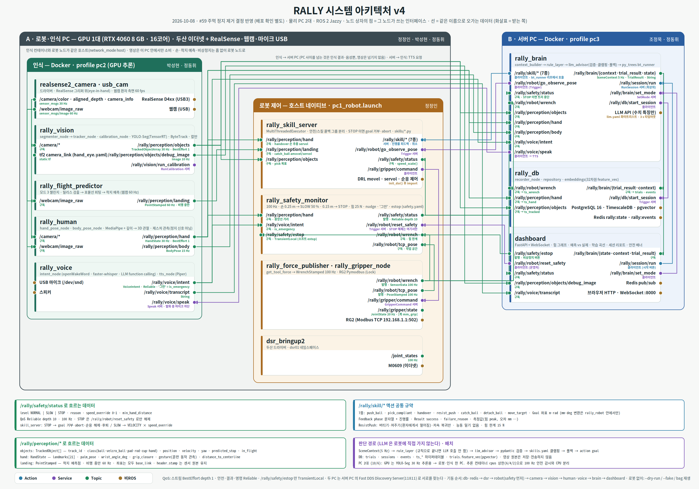
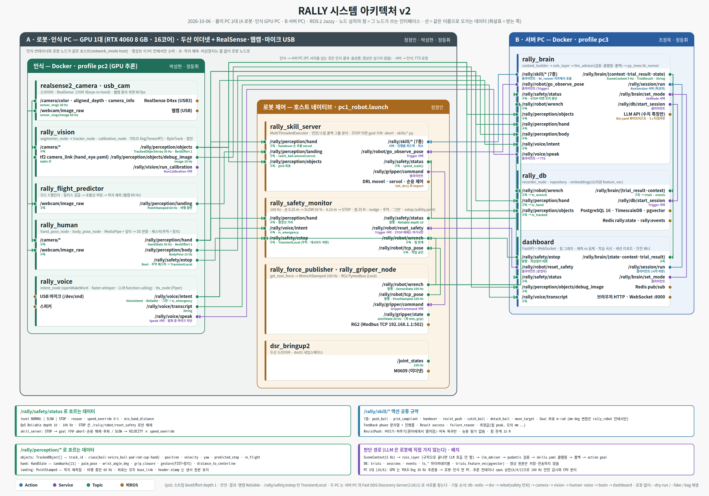
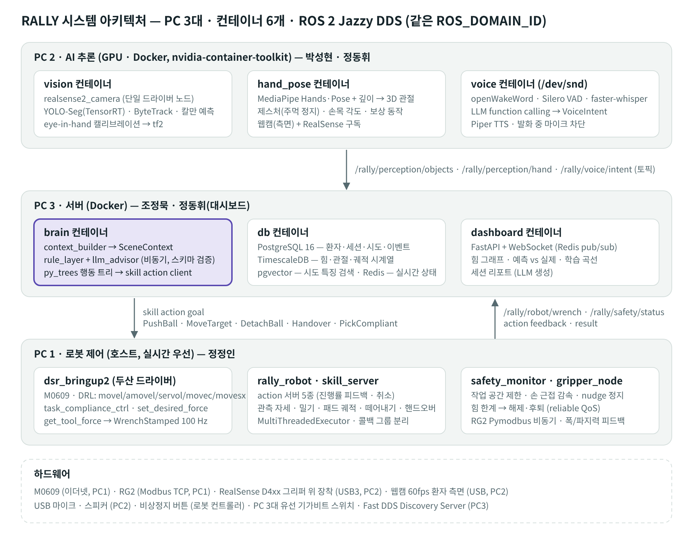

# RALLY — 테이블 건너편 재활 파트너 로봇 기획서

**R**ehabilitation **A**rm that **L**earns the ra**LLY** with you
공을 주고받는 "랠리", 그리고 회복한다는 뜻의 rally.

| 항목 | 내용 |
|---|---|
| 문서 버전 | v1.0 (2026-10-05) |
| 팀 | 정정인(로봇 제어) · 박성현(비전) · 정동휘(사람 인식·음성) · 조정묵(지능·인프라·HMI 대시보드) |
| 로봇 | 두산 M0609 + OnRobot RG2 |
| 센서 | RealSense D4xx (그리퍼 위 장착, eye-in-hand) · 웹캠(환자 측면) · USB 마이크 · 스피커 |
| 환경 | Ubuntu 24.04 · ROS 2 Jazzy · Docker · PostgreSQL/TimescaleDB/pgvector/Redis |
| 개발 기간 | 2026-10-06 ~ 10-13 (8일) |
| 저장소 | `rally/` (구조는 10절) |

---

## 목차

1. [프로젝트 개요](#1-프로젝트-개요)
2. [BRD — 비즈니스 요구사항](#2-brd--비즈니스-요구사항)
3. [시스템 범위와 훈련 모드](#3-시스템-범위와-훈련-모드)
4. [핵심 기술과 고도화 포인트](#4-핵심-기술과-고도화-포인트)
5. [정상상태 흐름 (Flowchart)](#5-정상상태-흐름-flowchart)
6. [시스템 아키텍처](#6-시스템-아키텍처)
7. [SRD — 시스템 요구사항](#7-srd--시스템-요구사항)
8. [Critical Point와 대응](#8-critical-point와-대응)
9. [시연 셋팅](#9-시연-셋팅)
10. [저장소 구조와 인터페이스](#10-저장소-구조와-인터페이스)
11. [개발 일정과 역할](#11-개발-일정과-역할)
12. [Phase 2 (이번 범위 밖)](#12-phase-2-이번-범위-밖)

---

## 1. 프로젝트 개요

### 1.1 한 줄 정의

로봇은 테이블 반대편에서 **공·패드·컵·손잡이 같은 물체를 통해서만** 환자와 상호작용하며(로봇이 환자를 잡거나 미는 동작은 없음), 상지 재활 훈련의 상대 역할을 하고, 동작과 힘을 측정·기록하며, 시도할수록 스스로 정확해지는 반자율 협동로봇.

### 1.2 왜 이 주제인가

- 현재 확보한 기반은 "말로 시키면 **정해진 좌표**의 물건을 옮기는 로봇"이다 (Whisper + ChatGPT API + YOLO + 고정 좌표 픽앤플레이스).
- 이 기반의 한계 세 가지를 깨는 것이 목표다.
  1. 물체 위치를 고정 좌표로 쓴다 → **핸드-아이 캘리브레이션 + 분할 마스크 기반 3D 위치**
  2. 로봇이 접촉을 느끼지 못한다 → **힘·순응 제어**
  3. 판단이 명령 → 실행 한 방향이다 → **상황 판단 + LLM 학습 루프**
- 재활 도메인은 "사람과 협업하는 반자율 협동로봇"이라는 과제 목표에 정확히 맞고, **로봇이 환자 쪽으로 능동적으로 움직이는 동작을 제어 설계에서 아예 제외**해(버티기·져주기·물체 전달만) 안전을 거리뿐 아니라 제어 구조로 확보했다.

### 1.3 평가 지표와의 연결

| 과제 요구 | RALLY에서 구현되는 곳 |
|---|---|
| RealSense 캘리브레이션 · Topic · Service · Interface | eye-in-hand 캘리브레이션, `rally_interfaces` 커스텀 msg/srv/action 19종 |
| Doosan 협동로봇 제어 | movel/amovel/servol/movec/movesx, 순응·힘 제어(모드 7 버티기·져주기), 힘 조건 감시 |
| RG2 그리퍼 + Modbus | Pymodbus 비동기, 폭·파지력 피드백으로 파지 판정 |
| Object Detection · 학습 · 추론 | YOLO-Seg 커스텀 데이터셋 학습, TensorRT 추론 |
| Voice Processing · Wakeup word · Keyword | openWakeWord 커스텀 호출어, faster-whisper, LLM function calling |
| Docker · DB · 다중 PC 통신 | 컨테이너 6개 / PC 2대, DB 4종 역할 분리, Fast DDS Discovery Server |

---

## 2. BRD — 비즈니스 요구사항

### 2.1 문제 정의

- 뇌졸중·어깨 수술 후 상지 재활은 뻗기·던지기·쥐기를 **수백 번 반복**해야 하는데, 치료사 1명이 환자 1명을 붙잡고 공을 주고받으며 결과를 수기로 기록한다.
- 평가가 치료사의 눈대중에 의존해 **사람마다 결과가 다르고**, 회복 추이를 수치로 남기기 어렵다.
- 기존 상지 재활 로봇(엔드이펙터형·외골격형)은 환자 팔을 **직접 잡는** 고가 전용 장비라 설치 공간과 비용 부담이 크다.

### 2.2 목표 사용자

| 사용자 | 역할 | 니즈 |
|---|---|---|
| 환자 (1차) | 로봇과 마주 **서서** 훈련 (10/8 결정, 모든 모드) | 지루하지 않은 반복, 즉각적인 피드백, 안전 |
| 치료사 (2차) | 세션 설정·모니터링, 리포트 확인 | 여러 환자 동시 관리, 객관적 수치, 기록 자동화 |
| 운영자 (팀) | 시연·유지보수 | 캘리브레이션·안전 점검 루틴 |

### 2.3 비즈니스 목표

| ID | 목표 | 측정 |
|---|---|---|
| BG-1 | 반복 훈련 상대 역할을 로봇이 맡아 치료사 1명이 여러 환자를 본다 | 세션 중 치료사 개입 없이 진행되는 시도 비율 |
| BG-2 | 동작 품질을 정량화해 회복 추이를 데이터로 남긴다 | 시도별 오차·관절 각도·성공률이 DB에 자동 기록 |
| BG-3 | 환자 상태에 맞춰 난이도를 스스로 조절한다 | 난이도 변경 결정의 근거가 리포트에 남음 |
| BG-4 | 로봇은 물체를 통해서만 환자와 상호작용하고, 환자 쪽으로 능동적으로 미는 동작이 없다 | 로봇 작업 공간이 중앙선을 넘지 않음(하드 제한) + 모드 7에서 로봇 이동 방향이 항상 환자에게서 멀어지는 쪽임을 로그로 증명 |

### 2.4 사업성

- 재활 전문 인력 부족과 평가 표준화 수요가 동시에 있다.
- 협동로봇 + RGB-D 카메라 + 일반 소품으로 구성되어 전용 재활 로봇 대비 저가·소형이고, 소규모 재활 병원·요양 시설·재택 보급 모델이 가능하다.
- 축적되는 시도 데이터(궤적·힘·관절)는 그 자체로 회복 평가 지표 연구에 쓸 수 있다.

### 2.5 범위

**Phase 1 (이번 8일)**: 훈련 모드 1·5·7(확정) + 모드 3(챌린지 — Day 6 성공률 기준으로 포함 여부 결정), 세션 흐름, 안전, 기록·리포트, 학습 루프
**Phase 2 (범위 밖, 12절)**: 모드 3 중간·후기 단계(반경 좁히기 → 패드 고정), 굴러오는 공 받기(구 장면 2), 블록 번갈아 쌓기(구 장면 4), VLA 비교 실험

---

## 3. 시스템 범위와 훈련 모드

> 아래 모드 설명에는 설계 목표가 포함된다. “기존 방식 대비” 행은 로봇 적용 목적과 2026-10-08 확인된 구현 범위를 구분한다. 기존 치료가 항상 눈대중·수기라는 뜻이나 임상적 우월성을 입증한 비교가 아니다. 미머지 작업본·미연결 기능을 배포 완료로 보지 않는다.

### 3.1 세션 구조

세션은 **모드 1 → (모드 3) → 모드 5 → 모드 7** 순서로 진행되며, 재활 관점에서 **큰 동작(팔 뻗기) → 협응(던지기, 챌린지) → 미세 동작(손목·쥐기) → 근력(등척성 밀기)** 순서다. 모드마다 여러 번 시도하고, 시도마다 "감지 → 예측·계획 → 로봇 동작 → 판정 → 결정·기록" 루프를 한 번 돈다.

**자세 (10/8 결정)**: 환자는 모든 모드를 **선 자세**로 한다. 테이블이 높아 앉으면 팔꿈치를 대거나 뻗기가 어렵고, 모드 3 던지기·모드 7 밀기는 서서 하는 편이 동작이 자연스럽다. 서 있으면 몸을 숙여 로봇 구역에 들어오거나 몸무게를 실어 미는 보상이 쉬워지므로 손 근접 감속·정지(CP10)와 보상 동작 감지(FR-05)가 그만큼 중요하다.

### 3.2 모드 1 — 공 굴려주기 (팔 뻗기 훈련)

| 항목 | 내용 |
|---|---|
| 시나리오 | 테이블에 **가이드 길 3개**(왼·가운데·오른쪽, 폭 10~12 cm)를 깔고, 로봇이 환자 손 위치에 맞는 길을 골라 공을 밀어 **닿을 듯 말 듯한 위치**에 멈추게 한다. 환자가 뻗어서 잡았다 놓으면 로봇이 공을 집어 거치대에 돌려놓는다. 길 덕분에 공이 직진해 밀기 → 정지 거리 관계가 깨끗하고, 길을 바꿔 뻗기 방향 훈련도 된다. |
| 한 시도 (10/8 회의·#85/#87 통합) | ① 손 보기 자세 → ② 손 위치에 가장 가까운 레인 → ③ 레인별 고정 목표(개발용 입구 +35 cm), 손 시작 거리 ≥ 목표+reach 확인(초기·단계 = 레인 RMSE × 2), 안전 NORMAL 대기. 실측·속도 범위와 중앙선 + max(patient_margin_m, safety STOP 거리 + 5 cm)로 제한 → Brain이 목표와 양수 속도(상한 0.37 m/s)를 PushBall에 전달 → ④ 타격 후 새 표본의 펼침→쥠 유지→펼침을 받기 후보로 기록. 실물 검증 전 자동 난이도 변경 차단 → 손 이탈 확인까지 세션 유지·대기(8 s 뒤 안내, 시간 초과로 종료하지 않음) → ReturnBall로 공 회수·거치대 복귀 → 시도 기록. 미검출은 이탈이 아니며 STOP·명시적 취소는 자동 재개하지 않음 |
| 로봇 기능 | `PushBall`(거치대 공 비전 집기 → 레인 입구 → 퍼터식 치기 → 손 보기 자세) · `ReturnBall`(레인 안 공 → 거치대) · `/rally/robot/go_hand_view` |
| 비전 | 공 마스크 추적, 멈춘 뒤 **실제 정지 위치 측정**. 정지 위치 예측은 **밀기 전에 레시피**(길별 밀기 속도 → 정지 거리)로 한다. 굴러가는 중 칼만 예측은 모드 3 에 먼저 쓰고, 그때 모드 1 에 붙일지 정한다 (#69) |
| 손 인식 | 환자 손 3D 위치 = 목표 지점 기준, 뻗기 거리 측정 |
| 학습 루프 | 매 시도 "밀기 속도·길 → 실제 정지 거리(+좌우 오차)" 기록 → LLM + pgvector 유사 시도 검색 → 다음 파라미터 제안. 길마다 마찰이 달라 학습 대상이 생김. **시도할수록 목표 오차가 줄어드는 곡선**이 이 모드의 쇼케이스 |
| 판정 | 타격 뒤 새 손 표본의 펼침 → 쥠 0.3 s 유지 → 펼침(HandState.grip_closure)을 **받기 후보**로 기록한다. 실제 공을 잡았다는 검증이 아니므로 자동 난이도 변경은 차단하며, 명시적 harder/easier만 시도 경계에서 반영한다. 실제 정지 위치·목표 오차를 측정하지 못하면 NaN으로 남긴다. |
| 기존 방식 대비 | 공을 반복 제시하는 동작과 시도 기록을 자동화해 치료사의 관찰을 돕는 것이 목적이다. **모드 1 통합 구현([PR #87](https://github.com/ImymemineJ/rally/pull/87))**은 손에 가장 가까운 레인을 고르고, 레인별 공 목표를 고정한 채 필요한 손 시작 거리로 난이도를 조절한다. 방향을 고르게 번갈아 선택하는 기능은 아니다. 손 시작 위치·목표 등은 기록하지만 실제 정지 위치·오차를 못 잰 경우 NaN으로 남기며, 측정이나 학습 효과가 검증된 것으로 보지 않는다. |

### 3.3 모드 3 — 던진 공 예측 요격 (던지기·협응 훈련) · 챌린지

> 기술 난이도가 가장 높아 **Day 6 CP13 결정**으로 포함 여부를 정한다. 빠져도 1·5·7로 세션이 성립한다.

| 항목 | 내용 |
|---|---|
| 시나리오 | 환자가 벨크로 공을 로봇 쪽으로 **살살 토스**한다. 로봇은 벨크로 패드를 들고 있다가 공이 날아오는 동안 착지점을 예측해 **미리 가서 패드로 받는다**. 받은 뒤 패드를 거치대에 걸고 공을 RG2로 떼어내 환자에게 건넨다. |
| 재활 설계 | 재활 동작은 환자의 **던지기**다. 로봇이 받으러 가는 건 치료사가 공을 받아주는 역할. Phase 1은 **초기 단계(격려)** — 로봇이 넓은 반경(`catch_radius` 0.35 m)에서 받아줘 환자가 던지기 자체에 집중하고 성공 경험을 쌓는다. Phase 2에서 반경을 좁히고(중간), 끝내 패드를 고정(후기)해 정밀도를 요구하는 **점진적 과부하** 구조. |
| 로봇 기능 | `CatchBall`(릴리스 감지 → 예측점으로 amovel 선행 이동 → 착지 직전 servol 미세 보정 → 패드 면 정렬) → `DetachBall`(힘 급락으로 떼어짐 판정) → `Handover`(GIVE) |
| 비전 | 측면 웹캠 60 fps로 공 비행 추적(패드가 RealSense 시야를 가릴 수 있음), 손·공 마스크 분리로 릴리스 검출, **포물선 피팅으로 착지점·시각 예측**(3~5프레임 후 첫 예측, 매 프레임 갱신), 패드 마스크 위 공 마스크로 명중·중심 오차 판정 |
| 궤적 해석·학습 | 실시간: 포물선 피팅(빠른 층). 시도 후: 예측 vs 실제 착지 오차, 반응 시간, 이동 거리, 환자 릴리스 속도·각도를 `TrialResult`로 기록 → LLM + pgvector가 **선행 시간·받아주는 반경** 제안. 고도화 옵션: 초반 0.15 s 궤적 → 착지점 회귀 모델을 리허설 데이터로 학습해 피팅과 비교 |
| 판정 | 비전(패드 위 공) 우선, 힘 충격 피크 보조. 받았는지와 무관하게 환자 던지기 지표는 항상 기록 |
| 안전 | 요격 이동도 중앙선 작업 공간 안에서만. 예측점이 경계 밖이면 경계로 클램핑, 공 속도 상한 초과 시 추적 포기(`too_fast`) |
| 기존 방식 대비 | 캐치볼 상대 역할과 관측·기록을 로봇으로 자동화하는 것이 목적이다. **Phase 1은 받아주는 반경 0.35 m를 고정한 챌린지 설계**이며, 통합·실측 검증이 남아 있다. 반경을 단계적으로 좁히는 기능은 Phase 2로 이번 범위 밖이다. 릴리스 속도·각도·반응 시간의 매 시도 측정·기록은 설계 목표이며 완료된 기능으로 주장하지 않는다. |

### 3.4 모드 5 — 기울인 물체 건네고 받기 (손목 회전·쥐기 훈련)

| 항목 | 내용 |
|---|---|
| 시나리오 | 로봇이 막대·컵을 여러 각도로 기울여 중앙선 앞에 내민다. 환자는 손목을 돌려 잡고, 당기면 로봇이 놓는다. 반대로 환자가 내밀면 로봇이 손 위치를 따라가 받는다. |
| 로봇 기능 | `Handover`(GIVE: 기울여 제시 → 당김 힘 감지 → 해제 / RECEIVE: servol 손 추종 → 순응 상태로 받기) |
| 비전 | 거치대 위 막대·컵의 마스크 주축으로 파지 각도 계산 |
| 손 인식 | 손 3D 위치(추종 목표), 잡는 순간 손목 각도, 쥐기 완료(grip_closure) |
| 판정 | 잡을 때 손목 각도, 핸드오버 소요 시간 |
| 기존 방식 대비 | 물체 제시 각도를 명령값으로 관리하고 건네기·돌려받기 순서를 반복하는 것이 목적이다. 현재 Brain은 **설정 범위에서 제시 각도를 무작위로 선택**하며 각도를 난이도에 따라 자동으로 단계 조절하지 않는다. 손목 각도·소요 시간은 스킬 결과로 기록하는 경로가 있으나 실제 측정 정확도·각도 재현성은 별도 검증이 필요하다. 손을 따라가 받는 동작은 현재 미구현이므로 구현 완료 기능으로 소개하지 않는다. |

### 3.5 모드 7 — 저항 밀기 (등척성 근력 훈련, 팔씨름형)

| 항목 | 내용 |
|---|---|
| 시나리오 | 로봇이 손잡이 막대를 쥐고 환자 앞(중앙선 앞)에 내민다. 환자가 손잡이를 밀면 로봇은 **순응 제어로 스프링처럼 버틴다**. 환자 힘이 목표(예: 8 N)를 2초 이상 유지하면 로봇이 천천히 **밀려나 준다**(져줌). 환자가 손을 놓으면 저속·저힘으로 시작 위치 복귀. |
| 재활 설계 | 뇌졸중 환자 상지 근력 회복의 표준인 **등척성(isometric) 밀기 훈련**. 강성·목표 힘이 난이도이며 환자 기록(최대 힘)의 60 %에서 시작해 연속 성공 시 올린다. "이겼다"는 피드백이 동기 유지. |
| 로봇 기능 | `ResistPush`: `task_compliance_ctrl` + `set_stiffnessx`(밀리는 축만 저강성), `get_tool_force` 20 Hz 힘 곡선, 목표 유지 판정 → 져주기 저속 movel, 복귀 중 접촉 감지 정지, `try/finally` 순응 해제. **로봇은 버티기·져주기·복귀만 하고 환자 쪽으로 능동적으로 미는 코드는 없다.** |
| 측정 | 최대 힘, 유지 시간, 힘 곡선 부드러움(떨림), 회차별 추세 → 치료사 리포트의 근력 지표. 힘 시계열은 `ts_wrench`와 `TrialResult.force_profile`에 저장 |
| 기존 방식 대비 | **목표 힘·유지 시간으로 과제를 정하고 목표 달성 시 져주는 피드백**을 제공하는 것이 목적이다. 현재 Brain은 강성을 기본 700 N/m로 고정하고, 규칙이 정한 난이도에 따라 목표 힘을 조절한다. 스킬 결과의 최대 힘·유지 시간·부드러움을 기록하는 경로는 있으나, 현재 main의 `ResistPush` 저항·져주기·힘 곡선 수집 실행부는 미구현이다. 구현 후 로봇·인식 PC 검증이 필요하다. 벽 밀기나 치료사 훈련보다 임상 효과가 우수하다는 주장은 하지 않는다. |
| 손 인식 | 손잡이를 잡았는지(grip_closure), 손잡이 외 로봇 링크 접근 감지 → 정지 |
| 음성 | "밀어보세요", "2초 버텼어요", "조금 더" / 환자 "힘들어요" → 목표 하향·휴식 |
| 안전 | 힘 한계 15 N(전체 한계 25 N보다 낮게), 초과 시 순응 해제·후퇴. 손잡이는 중앙선 앞에만. 치료사가 비상정지를 쥔 상태에서만 실행 |

### 3.6 공통 — 안전 (모드가 아니라 항상 켜진 감시)

| 수단 | 동작 |
|---|---|
| 작업 공간 제한 | 로봇 TCP가 중앙선을 넘지 못함 (DRL 작업 공간 + safety_monitor 이중) |
| 손 근접 감속 | 손이 중앙선 0.25 m 이내 → 속도 50 %, 0.15 m 이내 → 정지 |
| 3중 정지 | nudge(로봇을 톡 치면 힘 급변 감지) · 음성 "그만" · 비상정지 버튼(운영자). 손 근접 자동 감속·정지가 함께 동작. (주먹 제스처 정지는 10/8 #59 에서 뺌 — 쥐는 동작이 모드 1·5·7 훈련 자체라 매번 오탐, 실로봇에서 공을 쥐여 줄 때·받을 때 정지 → 다음 동작 거절.) **운영 규칙: 비상정지 버튼은 운영자가 항상 손에 닿게 둔다** (환자가 잘못 누를 위험, 버튼이 하나뿐 — #97 정정인 동의). nudge와 손 근접 감시에는 동작 조건이 있다. 이동·접촉 예정 구간에는 nudge를 판정하지 않고, 환자 접촉 구간의 손 근접은 깊은 침입 등 예외를 제외하면 STOP 대신 SLOW로 처리한다. 두 기능을 환자가 언제든 직접 정지할 수 있는 수단으로 간주하지 않으며, 운영자는 비상정지 버튼을 즉시 조작할 수 있어야 한다 |
| 힘 한계 | 25 N 초과 → 순응 해제 + 후퇴 |
| 하드웨어 | 비상정지 버튼 (운영자 손 닿는 곳) |
| 로봇 방향 제약 | 모드 7에서 로봇 TCP 이동 방향은 항상 환자에게서 멀어지는 쪽(져주기)이거나 저속 복귀뿐. 환자 방향 능동 이동은 코드에 없음 |

---

## 4. 핵심 기술과 고도화 포인트

각 기술을 "지금 된 것 → 이번에 올리는 것" 형태로 정리한다. 전부 모드 어딘가에서 **없으면 성립이 안 되는** 자리에 있다.

### 4.1 핸드-아이 캘리브레이션 (eye-in-hand)

- **지금**: 체커보드 내부 파라미터만. 카메라가 물체를 찾아도 로봇은 정해진 좌표로 이동.
- **이미 있는 것**: 선생님 `Calibration_Tutorial`로 구한 `T_gripper2camera.npy`(eye-in-hand 변환)가 코드에 포함되어 있다. Day 1은 새로 구하는 게 아니라 `verify.py`로 오차를 재는 것부터 시작한다.
- **이번**: 오차가 5 mm를 넘으면 체커보드/ArUco를 로봇 자세 15개 이상에서 재촬영해 `cv2.calibrateHandEye`로 **tool0 → camera_link** 변환을 다시 구하고 tf2 static transform으로 등록. 비전 노드는 매 프레임 timestamp가 일치하는 tf를 조회해 base_link 좌표로 변환한다.
- **검증**: 기준점 터치 — TCP를 마커 위에 두고 비전 좌표와 비교, 목표 오차 5 mm 이내. 시연 직전 루틴으로 고정.
- **주의**: 카메라가 팔과 함께 움직이므로 감지할 때는 테이블 전체가 보이는 **관측 자세**로 올라가 촬영한다 (`/rally/robot/go_observe_pose`).

### 4.2 YOLO-Segment

- **지금**: 박스 탐지로 "뭐가 어디 있다"까지.
- **이번**: 픽셀 마스크로 물체 모양을 그대로 얻는다. 필요한 이유 네 가지.
  1. **파지 각도** — 2지 그리퍼는 방향이 틀리면 못 잡는다. 마스크 주축(PCA)으로 손목 회전각 계산 (모드 5 막대·컵, 모드 3 공 회수).
  2. **정확한 3D 위치** — 박스 안의 테이블 픽셀이 깊이 평균을 오염시킨다. 마스크 픽셀 깊이만 써서 중심 계산 (모드 1 공 정지 위치).
  3. **순간 검출** — 손 마스크와 공 마스크가 실제로 떨어지는 프레임 = 릴리스 시점 (모드 3). 박스는 겹친 채로 남아 부정확.
  4. **패드 위 공 위치** — 패드 마스크 안에서 공 마스크를 분리해 중심 오차 계산 (모드 3 명중 판정). 박스로는 겹쳐서 불가.
- **고도화**: 소품별 커스텀 데이터셋 폴리곤 라벨링(Roboflow) → 파인튜닝 → TensorRT 변환으로 FPS 비교 제시.

### 4.3 움직이는 물체 추적·예측

- **지금**: 정지 물체만.
- **이번**: ByteTrack으로 프레임 간 ID 유지. 모드 1은 **밀기 전에 레시피(길별 밀기 속도 → 정지 거리)로 정지 위치를 예측**하고 멈춘 뒤 실제 위치를 잰다. 길이 일직선이라 맞출 값이 정지 거리 하나뿐이고, 밀고 나면 로봇이 공을 고칠 수 없으며, 손목 RealSense 는 굴러가는 구간을 거의 못 보기 때문이다 (#69). 굴러가는 중 칼만 예측(`rally_vision/predictor.py`)은 모드 3 에 먼저 쓰고, 그때 모드 1 에 붙일지 정한다. 모드 3은 웹캠 60 fps로 던진 공을 추적해 릴리스 후 5프레임 안에 **포물선 피팅으로 착지점·시각을 예측**하고 매 프레임 갱신, 로봇이 그 점으로 **미리 가서 패드로 받는다**(예측 요격). 예측과 실제의 차이를 대시보드에 함께 표시해 모델 정확도를 보여준다.
- 모드 1 길별 레시피 계수(감속·밀기 구간)는 매 시도 목표 대비 정지 위치 오차로 보정한다 (학습 루프).

### 4.4 3D 손 관절·모션 인식

- **지금**: 미사용.
- **이번**: MediaPipe Hands(21점)·Pose(33점)의 2D 랜드마크에 RealSense 깊이를 입혀 3D 관절로 복원. 손바닥 좌표계, 손목 회전각, 손가락 굽힘(grip_closure), 몸통 기울임(보상 동작), 주먹 정지 제스처를 계산해 `HandState`·`BodyPose`로 발행.
- 모드 5에서는 손 위치를 30 Hz로 보내 로봇이 **servol로 따라가며 받는다** — 움직이는 대상을 실시간 추종하는 기술이 여기서 살아난다.

### 4.5 힘·순응 제어

- **지금**: movej/movel 위치 제어만.
- **이번**: 로봇이 접촉을 느끼고 반응한다.
  - `task_compliance_ctrl` + `set_stiffnessx`: Z 저강성으로 테이블에 부드럽게 닿은 뒤 파지 (PickCompliant)
  - `check_force_condition`: 공 접촉 순간(PushBall), 당김 힘 감지(Handover GIVE)
  - 힘 시계열 변화율: 벨크로 공이 떨어지는 순간의 **힘 급락** 검출 (DetachBall), 패드 충격 피크(CatchBall 보조)
  - nudge 감지: 사람이 로봇을 톡 치면 정지
- 이동 명령도 movec(원), movesx(스플라인 8자), moveb(다점 블렌딩), amovel(비동기), servol(스트리밍)까지 사용.

### 4.6 LLM 궤적 해석·학습 루프

- **지금**: ChatGPT가 음성 명령을 해석.
- **이번**: 시도 결과를 해석하고 다음 파라미터를 제안한다. 구조는 **2단**.
  - 빠른 층(실시간): 칼만·피팅·규칙이 예측과 즉시 판단을 맡는다.
  - 느린 층(비동기, 수 초): `SuggestParams` 서비스로 최근 시도 특징(오차, 속도, 방향, 타이밍)을 JSON으로 보내고, pgvector에서 유사한 과거 시도를 검색해 예시로 함께 넣는다. 출력은 JSON 스키마 검증 + 허용 범위 클램핑 후에만 적용.
  - 검색은 **pgvector 유사 시도 + Graph RAG(지식 그래프 맥락)** 를 함께 쓴다 (4.10).
- **학습이 보이는 지점**: 모드 1 목표 오차 감소 곡선(주), 모드 3 선행 시간·반경 보정(백업).
- **데이터 보호**: 영상은 외부로 보내지 않고 익명화된 특징값만 전송 (`llm.yaml` 화이트리스트).

### 4.7 문맥 기반 상황 판단

- **지금**: 명령 하나 = 동작 하나, 실패하면 멈춤.
- **이번**: `context_builder`가 모드·시도 결과 추세·손/몸 상태·음성·안전 상태·DB 이력을 `SceneContext`로 묶는다. 확실한 것(안전, 연속 성공 → 난이도 상승)은 **규칙 레이어**가, 애매한 것(피로 징후 + "힘들어요", 반복 실패 원인)은 **LLM function calling**이 미리 정한 행동 목록 중에서 고른다. 결과는 **py_trees 행동 트리**가 실행하고, 실패 시 재탐지·재시도·대기 같은 복구 분기로 간다.

### 4.8 음성 인터페이스

- **지금**: Whisper 명령 인식.
- **이번**: openWakeWord 커스텀 호출어("랠리야"), Silero VAD로 발화 구간 검출 + faster-whisper 스트리밍, LLM function calling으로 `VoiceIntent` 구조화, Piper TTS 피드백, TTS 중 마이크 차단(half-duplex), "그만"은 STT를 거치지 않고 안전 토픽으로 직결.

### 4.9 인프라 (ROS 2 · Docker · DB)

- **ROS 2**: 커스텀 인터페이스 19종(msg 8, srv 5, action 6), Lifecycle 기동 순서, QoS 분리(스트림 BestEffort / 안전·결과 Reliable / estop TransientLocal), MultiThreadedExecutor + 콜백 그룹으로 100 Hz 안전 감시 분리, tf2 좌표계, ros2 bag 재현, 노드별 지연 측정.
- **Docker**: 서비스별 이미지 6개(멀티 스테이지), GPU·오디오·USB 패스스루, healthcheck 의존, PC별 compose 프로필, host 네트워크 + Fast DDS Discovery Server, GitHub Actions 빌드.
- **DB (역할별 4종)**: PostgreSQL(환자·세션·시도 관계형), TimescaleDB(힘·관절·궤적 하이퍼테이블, 연속 집계), pgvector(시도 특징 벡터 유사 검색), Redis(실시간 상태·대화 문맥·대시보드 pub/sub).

### 4.10 지식 계층 — Ontology · Knowledge Graph · Graph RAG · 시맨틱 레이어

- **필수 사용**: 네 가지 모두 조정묵 담당 범위(rally_brain, rally_db)에서 구현하고, 판단·학습 루프·리포트 중 최소 한 곳에서 실제로 활용한다. **구체적인 활용 방식은 추후 결정**(TBD)하며, 결정되면 이 절과 FR-20~23의 검증 기준을 갱신한다.

| 구성 | 역할 | 구현 위치(예정) | 일정 |
|---|---|---|---|
| Ontology | 개념과 관계 정의 — 모드 → 훈련 동작 → 신체 부위, 보상 동작 → 피로 신호, 스킬 → 파라미터·허용 범위 | `rally_brain/knowledge/ontology.yaml` | Day 2 |
| 시맨틱 레이어 | 성공률·피로도·회차별 개선율 같은 지표를 한 곳에서 정의해 규칙 레이어·LLM·대시보드·리포트가 같은 계산을 쓴다 | `rally_bringup/config/metrics.yaml` + SQL 뷰(`schema_003_*.sql`) | Day 3 |
| Knowledge Graph | 실제 데이터 연결 — 환자 → 세션 → 시도 → 파라미터 → 관찰된 보상 동작, 노드 타입은 Ontology를 따른다 | PostgreSQL 노드·엣지 테이블(`schema_002_*.sql`), recorder가 기록 | Day 5 |
| Graph RAG | LLM 호출 시 pgvector 유사 시도에 더해 지식 그래프의 관련 맥락(최근 보상 동작, 관련 훈련 동작, 허용 범위)을 함께 넣는다 | `rally_brain/graph_rag.py`, `llm_advisor` 검색 단계 | Day 6 |

- **제약** (기존 규칙 그대로):
  - 새 DB를 추가하지 않는다. 지식 그래프는 기존 PostgreSQL에 둔다.
  - 기존 스키마 파일은 고치지 않고 마이그레이션 파일을 추가한다.
  - 외부 LLM에 보내는 그래프 정보도 `llm.yaml` 화이트리스트를 따른다. 환자 식별 정보는 보내지 않는다.
  - Graph RAG는 LLM의 **입력**만 늘린다. LLM 출력은 지금처럼 스키마 검증 → 범위 클램핑 → 규칙 폴백을 거친다.

---

## 5. 정상상태 흐름 (Flowchart)



### 5.1 단계 설명

| 단계 | 담당 노드 | 내용 |
|---|---|---|
| 시스템 기동 | rally_bringup | Lifecycle 순서: db/redis → robot(safety 먼저) → camera/vision → human/voice → brain → dashboard |
| 세션 시작 | voice → brain → db | 웨이크워드 + "훈련 시작" → 환자 ID 확인 → 지난 세션 결과로 시작 난이도 결정 |
| 모드 선택 | brain/bt_runner | 세션 트리가 모드 1 → (3) → 5 → 7 순서로 서브트리 실행 |
| 감지 | vision, human | 관측 자세에서 `TrackedObjectArray`, `HandState`, `BodyPose` 수신 |
| 예측·계획 | brain, vision | 정지 거리 예측(모드 1 레시피)·착지점 예측(모드 3), 궤적 패턴 선택, 이번 시도 파라미터 확정 |
| 로봇 동작 | robot/skill_server | 해당 모드의 action 실행 (순응·힘 조건 감시 포함) |
| 판정 | vision + robot | 정지 위치 오차 / 패드 명중·중심 오차 / 그리퍼 폭 / 손목 각도 |
| 규칙 결정 가능? | brain/rule_layer | 안전·명확한 추세는 규칙으로 즉시, 애매하면 LLM |
| LLM 판단 | brain/llm_advisor | 비동기, 3 s 타임아웃, 스키마 검증 실패 시 규칙 기본값 |
| 결정·피드백·기록 | brain, voice, db | 난이도/휴식/교정 → TTS, `TrialResult` → DB(trials, ts_*, feature_vec) |
| 세션 종료? | brain | 모드별 시도 횟수 완료 또는 음성 "끝" |
| 세션 리포트 | brain/llm_advisor → db → dashboard | 회차별 변화 해석, 치료사용 리포트 저장·표시 |

### 5.2 모드별 시도 루프

**모드 1 공 굴려주기**
감지(손 보기 자세에서 환자 손 3D) → 계획(손에 가까운 레인, 고정 목표 → 레시피 속도 → 난이도별 손 시작 거리·NORMAL 대기) → 동작(PushBall: 거치대 공 집기 → 놓기 → 치기 → 손 보기) → 판정(손 쥐었다 폄 = 받기 후보, 실측 정지 위치 오차·미측정 NaN) → 회수(손이 빠지면 ReturnBall: 레인 공 → 거치대) → 학습(TrialResult 저장, 고정 목표·손 시작 거리 기록, 자동 난이도 차단)

**모드 3 던진 공 요격**
감지(릴리스 검출, 공 비행 추적 60 Hz) → 예측(포물선 피팅 착지점, 매 프레임 갱신) → 동작(CatchBall: amovel 선행 이동 → servol 보정 → 패드 접촉 → 패드 거치 → DetachBall → Handover GIVE) → 판정(패드 위 공 여부, 예측 오차, 반응 시간, 릴리스 속도, 보상 동작) → 학습(선행 시간·반경 보정, 난이도 조절)

**모드 7 저항 밀기**
감지(손잡이 파지 여부, 손 위치) → 계획(지난 최대 힘 기준 목표 힘·강성) → 동작(ResistPush: 제시 → 순응 버티기 → 목표 유지 시 져주기 → 복귀) → 판정(최대 힘, 유지 시간, 부드러움) → 학습(목표 힘 조절, 근력 추이)

**모드 5 건네고 받기**
감지(거치대 물체 주축, 손 3D) → 계획(가동 범위 기록으로 제시 각도) → 동작(PickCompliant → Handover GIVE / RECEIVE with follow_hand) → 판정(손목 각도, 쥐기 완료, 소요 시간) → 학습(가동 범위 추이 기록)

### 5.3 안전 인터럽트

`safety_monitor`는 별도 콜백 그룹에서 100 Hz로 돌며 `SafetyStatus`를 발행한다. `LEVEL_SLOW`면 skill_server가 속도 오버라이드를 낮추고, `LEVEL_STOP`이면 실행 중인 action을 abort 하고 순응 해제 → 후퇴한다. 복구는 운영자가 `/rally/robot/reset_safety`를 호출할 때만.

---

## 6. 시스템 아키텍처

**v4 — #59 주먹 정지 제거 결정 반영** (2026-10-08, 물리 PC 2대). `docs/images/src/architecture_v4.py`로 생성한다. 손 제스처는 관측값으로 유지하지만 주먹을 STOP에 연결하지 않는다. 준비·재개 제스처는 이번 변경에서 추가하지 않는다.

이 그림은 합의한 구조이며 실제 배포 완료를 뜻하지 않는다. 손 노드·safety_monitor의 두 정지 경로 제거는 정동휘 PR과 정정인 리뷰·배포 확인에 따른다. 안전 코드·인터페이스·FR-07 변경은 해당 PR에서 함께 반영한다. 근거: [#59 PM 동의](https://github.com/ImymemineJ/rally/issues/59#issuecomment-6055479547).



<details><summary>이전 버전 — v3 (PC 2대, 주먹 정지 제거 전) · v2 (PC 3대) · v1 (개요)</summary>

이전 그림의 주먹 정지 문구·연결은 과거 설계 기록이다.






</details>

### 6.1 배치 원칙

물리 PC는 **2대**다 (2026-10-06 결정). `pc1`/`pc2`/`pc3` 는 launch·compose 프로필의 **역할 이름**이고 PC 번호가 아니다.

- **로봇·인식 PC (GPU, RTX 4060 8 GB · 16코어)**: 두산 드라이버·RG2·안전 감시·스킬 서버는 **호스트 네이티브**(역할 `pc1`, 컨테이너 오버헤드 없이). 무거운 추론(YOLO-Seg, MediaPipe, Whisper)은 같은 PC의 **컨테이너 3개**(역할 `pc2`, compose `cpus` 상한으로 로봇 노드와 CPU 분리). RealSense·웹캠·마이크 USB 는 모두 이 PC. RealSense 드라이버는 vision 컨테이너에서 **하나만** 띄우고 hand_pose 가 구독한다.
- **서버 PC**: 판단(brain), 저장(db·redis), 표시(dashboard), 그리고 DDS Discovery Server (역할 `pc3`). GPU·저지연 불필요.
- 합친 이유: GPU 가 한 대뿐이고 GPU 는 학습이 아니라 **실시간 추론**(YOLO-Seg 30 Hz, CPU 로는 5~10 fps)에 필요하다. 카메라 → 인식 → 로봇의 시간 임계 경로가 한 PC 안에서 끝나 네트워크 홉이 없고, 컬러+깊이 30 Hz 영상(기가비트 대역의 대부분)이 네트워크를 타지 않는다.
- 주의: 추론 컨테이너에 CPU 상한을 두어 100 Hz 안전 감시가 밀리지 않게 한다. RealSense 와 웹캠은 서로 다른 USB 컨트롤러 포트에 꽂는다. 이 PC 가 죽으면 로봇·인식이 같이 죽는다 (시연 수준에서 감수).

### 6.2 데이터 흐름

1. 센서 → 인식 컨테이너(로봇·인식 PC) → `/rally/perception/*`, `/rally/voice/intent` 토픽 (BestEffort, 최신 프레임만). 손·착지 예측·비상정지는 같은 PC 의 로봇 노드가 직접 구독 (PC 간 홉 없음)
2. brain(서버 PC)이 `SceneContext`를 만들고 행동 트리가 로봇 노드의 skill action을 호출
3. 로봇 노드는 `WrenchStamped`(100 Hz)·`SafetyStatus`·action feedback을 되돌림
4. 시도가 끝나면 `TrialResult` → rally_db recorder → PostgreSQL/Timescale/pgvector, Redis pub/sub → dashboard WebSocket

### 6.3 통신 설계

- 같은 `ROS_DOMAIN_ID`, 모든 컨테이너 `network_mode: host`
- PC 사이는 **Wi-Fi(Rokey_A)** 로 간다 (10/6 결정, 유선 스위치 없음). PC1+PC2 통합으로 카메라→인식→로봇 경로가 한 PC 안이라 Wi-Fi 를 타는 것은 인식 결과·안전 상태·action·대시보드 토픽뿐이다. 호스트 네이티브 노드도 `scripts/env_robot_pc.sh` 로 Discovery Server 클라이언트 설정을 맞춘다
  - 인식 결과(`/rally/perception/*`)는 BestEffort depth 1 이라 지연이 튀어도 최신 것만 쓴다. 반면 `/rally/safety/status`(Reliable depth 10), action goal·result(Reliable), `/rally/safety/estop`(Reliable + TransientLocal)은 패킷이 빠지면 재전송하므로 Wi-Fi 에서 지연이 **더 늘어난다**. brain 의 트리 중단·결과 수신이 늦어질 수 있다는 뜻이고, Day 1 에 `scripts/measure_latency.py` 로 PC 간 지연을 재서 기록한다
  - 안전 정지 수단('그만' 음성 · nudge · 손 근접 자동 정지)은 모두 로봇·인식 PC 안에서 처리되어 **Wi-Fi 를 타지 않는다**. 예외는 서버 PC 대시보드의 비상정지 버튼 하나로, Wi-Fi 지연을 그대로 받으므로 **보조 수단**이다. 하드웨어 비상정지 버튼은 네트워크와 무관하다
- Fast DDS Discovery Server(서버 PC)로 멀티캐스트 탐색 트래픽 제거
- 영상은 로봇·인식 PC 내부에서만 소비(디버그 영상만 10 Hz로 압축 발행). PC 사이를 오가는 것은 인식 결과·상태·결과 토픽뿐
- 노드별 `header.stamp` 대비 수신 시각 차이를 `scripts/measure_latency.py`로 측정해 예측 선행 시간에 반영

인터페이스 전체 명세는 [`INTERFACES.md`](INTERFACES.md).

---

## 7. SRD — 시스템 요구사항

### 7.1 기능 요구사항

| ID | 요구사항 | 모드 | 담당 | 검증 |
|---|---|---|---|---|
| FR-01 | 로봇 자세 15개 이상으로 eye-in-hand 캘리브레이션을 수행하고 tf2 static transform으로 등록한다 | 공통 | 박성현 | 기준점 터치 오차 ≤ 5 mm |
| FR-02 | 관측 자세에서 테이블 위 공·패드·막대·컵·손을 분할 마스크로 탐지하고 base_link 3D 위치·주축을 발행한다 | 공통 | 박성현 | mAP50 ≥ 0.85, 30 Hz |
| FR-03 | 공을 ID 유지하며 추적해 실제 정지 위치를 재고, 밀기 전 레시피로 정지 위치를 예측한다 (#69) | 1 | 박성현·정정인 | 예측–실제 오차 ≤ 30 mm (0.3 m/s 이하) |
| FR-03b | 던진 공을 웹캠 60 fps로 추적하고 릴리스 후 5프레임 안에 착지점을 예측, 매 프레임 갱신한다 | 3 | 박성현 | 최종 예측–실제 오차 ≤ 50 mm, 첫 예측 ≤ 100 ms |
| FR-04 | 환자 손 21점 3D 관절, 손목 각도, 쥐기 정도, 제스처(주먹·펼침 — 정지 수단 아님)를 30 Hz로 발행한다 | 공통 | 정동휘 | 손 검출률 ≥ 95 % (정면 시야) |
| FR-05 | 팔을 뻗은 순간의 보상 동작(앞으로 숙이기, 뻗는 쪽 어깨 으쓱)을 평소 자세 대비로 감지한다. 측면 대각 웹캠 한 대로는 팔을 굽히면 관절이 가려 틀어지므로 팔을 뻗은 동안만 잰다 (10/8 실측·결정) | 1·5·7 | 정동휘 | 앞으로 숙이기 15°, 어깨 으쓱 10° 이상 시 플래그 |
| FR-06 | 커스텀 웨이크워드 → VAD → STT → 의도 구조화 → TTS 피드백을 수행하고 TTS 중 마이크를 차단한다 | 공통 | 정동휘 | 호출어 오탐 ≤ 1회/10분, 의도 정확도 ≥ 90 % |
| FR-07 | "그만"·nudge·비상정지 버튼 중 하나로 0.3 s 이내 정지한다 (주먹 제스처는 #59 에서 뺌) | 공통 | 정정인·정동휘 | 10회 전수 테스트 |
| FR-08 | TCP가 중앙선을 넘지 않고, 손 근접 시 속도를 단계적으로 낮춘다 | 공통 | 정정인 | 경계 접근 테스트 |
| FR-09 | 순응 제어로 테이블 접촉을 감지한 뒤 물체를 집는다 (PickCompliant) | 공통 | 정정인 | 접촉력 ≤ 10 N, 파지 성공 ≥ 90 % |
| FR-10 | 지정 속도·방향으로 공을 밀고 접촉 순간을 힘으로 감지한다 (PushBall) | 1 | 정정인 | 접촉 감지 지연 ≤ 50 ms |
| FR-11 | 공 릴리스 후 착지점 예측을 구독해 패드를 예측점으로 선행 이동·보정하고 착지점에 맞춘다 (CatchBall) | 3 | 정정인 | 살살 토스 기준 요격 성공률 ≥ 70 % (반경 0.35 m) |
| FR-12 | 거치대의 패드에서 벨크로 공을 떼어내고 힘 급락으로 떼어짐을 판정한다 (DetachBall) | 3 | 정정인 | 성공 ≥ 90 %, 당김 ≤ 15 N |
| FR-13 | 물체를 지정 각도로 기울여 제시하고 당김 힘 감지 시 놓는다; 손을 추종해 받는다 (Handover) | 5 | 정정인·정동휘 | 해제 지연 ≤ 200 ms |
| FR-14 | 패드 위 공의 명중 여부와 중심 오차를 비전으로 판정한다 | 3 | 박성현 | 판정 정확도 ≥ 95 % |
| FR-14b | 손잡이를 내밀고 순응 강성으로 버티며 힘 곡선을 기록, 목표 힘 유지 시 져주고 저속 복귀한다. 환자 방향 능동 이동 없음 (ResistPush) | 7 | 정정인 | 힘 한계 15 N 전수 테스트, 로그상 이동 방향 검증 |
| FR-15 | 상황 요약(SceneContext)을 5 Hz로 만들고 규칙 → LLM 2단으로 다음 행동을 결정한다 | 공통 | 조정묵 | 문맥 유무 비교 사례 10개 |
| FR-16 | 최근 시도와 유사 과거 시도를 바탕으로 LLM이 다음 파라미터를 제안하고 범위 클램핑 후 적용한다 | 1 (3 백업) | 조정묵 | 10회 시도 후 오차 ≥ 30 % 감소 |
| FR-17 | 행동 트리로 세션(1→3→5)을 진행하고 실패 시 재탐지·재시도·대기로 복구한다 | 공통 | 조정묵 | 모의 실패 주입 테스트 |
| FR-18 | 모든 시도·힘·관절·궤적을 DB에 기록하고 세션 리포트를 생성한다 | 공통 | 조정묵 | 세션 종료 후 리포트 자동 표시 |
| FR-19 | 대시보드에 힘 그래프, 예측 vs 실제, 학습 곡선, 리포트를 실시간 표시한다 | 공통 | 조정묵 | 1 s 이내 갱신 |
| FR-20 | 모드·훈련 동작·신체 부위·보상 동작·스킬·파라미터의 개념과 관계를 Ontology로 정의한다 | 공통 | 조정묵 | 활용 방식 확정 후 결정 (TBD) |
| FR-21 | 주요 지표(성공률·피로도·개선율 등)를 시맨틱 레이어 한 곳에서 정의하고 규칙 레이어·LLM·대시보드·리포트가 공유한다 | 공통 | 조정묵 | 활용 방식 확정 후 결정 (TBD) |
| FR-22 | 세션·시도·파라미터·관찰 결과를 Ontology에 맞춘 Knowledge Graph로 기록한다 | 공통 | 조정묵 | 활용 방식 확정 후 결정 (TBD) |
| FR-23 | LLM 호출 시 pgvector 유사 시도와 Knowledge Graph 맥락을 함께 검색해 입력으로 쓴다 (Graph RAG) | 1 (3 백업) | 조정묵 | 활용 방식 확정 후 결정 (TBD) |

### 7.2 비기능 요구사항

| ID | 항목 | 요구 |
|---|---|---|
| NFR-01 | 지연 | 카메라 → 탐지 결과 발행 ≤ 60 ms, 웹캠 → 착지 예측 발행 ≤ 40 ms, 안전 정지 명령 전파 ≤ 20 ms |
| NFR-02 | 실시간성 | 안전 감시 100 Hz 유지, 다른 콜백에 블로킹되지 않음 (콜백 그룹 분리) |
| NFR-03 | 안전 | 로봇 작업 공간 하드 제한, 힘 한계 25 N(모드 7은 15 N), 3중 정지 + 하드웨어 비상정지, 모드 7 로봇 이동 방향 제약 |
| NFR-04 | LLM 격리 | LLM 응답은 로봇 명령으로 직접 전달되지 않음; 스키마 검증·범위 클램핑·타임아웃(3 s) 후 규칙 폴백 |
| NFR-05 | 개인정보 | 영상 원본은 외부 전송·DB 저장 금지, 외부 LLM에는 익명 특징값만 |
| NFR-06 | 재현성 | 모든 시연 시도를 ros2 bag(영상 제외)과 DB로 재현 가능 |
| NFR-07 | 배포 | `docker compose --profile pcN up` 한 줄로 PC별 기동, CI에서 colcon build·이미지 빌드 통과 |
| NFR-08 | 기동 | Lifecycle 순서 보장, 하나라도 비활성 시 brain은 세션을 시작하지 않음 |

### 7.3 데이터 요구사항

- `patients` → `sessions` → `trials` → `events` 관계형 구조 (`rally_db/schema.sql`)
- `trials.params/metrics/decision` JSONB, `trials.feature_vec vector(32)` (pgvector HNSW, `schema_002_hnsw.sql`)
- `ts_wrench`(100 Hz), `ts_tracked`(30 Hz), `ts_hand`(30 Hz) 하이퍼테이블, 보관 14일
- Redis: `rally:state`(로봇·세션 상태), `rally:dialog`(최근 대화, TTL 5분), 채널 `rally:events`
- 지식 그래프: PostgreSQL 노드·엣지 테이블(`schema_002_*.sql`), 노드 타입은 `ontology.yaml`을 따른다
- 시맨틱 레이어: 지표 정의 `metrics.yaml` + SQL 뷰(`schema_003_*.sql`)

### 7.4 외부 인터페이스

| 대상 | 방식 |
|---|---|
| M0609 | dsr_bringup2 (ROS 2) + DRL Python API, 이더넷 |
| RG2 | Modbus TCP (Pymodbus 비동기), 레지스터: 폭·힘·상태 |
| RealSense | realsense2_camera, USB 3 |
| LLM | OpenAI API (function calling, JSON schema) |
| 대시보드 | HTTP/WebSocket :8000 |

---

## 8. Critical Point와 대응

| # | 리스크 | 영향 모드 | 대응 |
|---|---|---|---|
| CP1 | 핸드-아이 오차 | 전체 | 15개 이상 자세, 시연 전 기준점 터치 루틴, 오차 > 5 mm면 재캘리브레이션 |
| CP2 | 전체 지연(카메라→로봇) | 1·5 | 노드별 타임스탬프 측정 → 예측 선행 시간 반영, TensorRT, depth 1 QoS |
| CP3 | 패드가 RealSense 시야를 가림 | 3 | **Day 0 실측**. 공 비행 추적은 측면 웹캠이 주(단안 → 공 지름·테이블 평면으로 거리), RealSense는 떼어내기 근접 작업에만 |
| CP3b | 요격 시간 창 | 3 | 토스 비행 0.5~0.8 s. 전체 지연 ≤ 100 ms, `lead_time_s`로 보상, 공 속도 상한 초과 시 `too_fast` 포기. 대기 자세를 테이블 중앙에 두어 이동량 최소화 |
| CP4 | 공 굴림 모델 오차 | 1 | 레시피 계수를 매 시도 정지 위치 오차로 보정, 같은 속도 반복성(정지 위치 표준편차) 측정, 공 속도 0.3 m/s 이하, 펠트 상태 고정 (#69) |
| CP5 | 벨크로 떼어내기 실패 | 3 | 당김 방향을 패드 면에 수직으로, 힘 급락 임계를 리허설 데이터로 결정, 실패 시 각도 바꿔 재시도(행동 트리) |
| CP6 | 손 관절 결측 | 5 | 깊이 보간, 웹캠 보조, 짧은 결측은 칼만, 0.5 s 이상 결측 시 추종 중단 |
| CP7 | 힘 센서 오탐 | 3·5 | 정지 구간에서만 충격 판정, 저역 필터 + 변화율 임계, 로봇 가속 구간 마스킹 |
| CP8 | LLM 지연·오출력 | 1 | 비동기 호출, 3 s 타임아웃, 스키마 검증, 범위 클램핑, 규칙 폴백 |
| CP9 | 음성 오인식 | 전체 | VAD, TTS 중 마이크 차단, 위험 명령 되묻기, "그만"은 키워드 스팟팅으로 직결 |
| CP10 | 사람 안전 | 전체 | 중앙선 작업 공간 제한, 손 근접 감속, 3중 정지, 하드웨어 비상정지 |
| CP11 | 모드 1 학습 곡선 미달 | 1 | Day 6 결정 지점: 학습 루프를 모드 3 선행 시간·반경 보정으로 이전 |
| CP13 | 요격 성공률 미달 (챌린지) | 3 | Day 4 중간 점검 → Day 6 결정: 반경 확대(0.5 m)·바운드 토스로도 70 % 미만이면 모드 3을 시연에서 빼고 1·5·7로 간다. 시도 데이터는 발표에 "도전 과제"로 제시 |
| CP14 | 모드 7 접촉 안전 | 7 | 힘 한계 15 N, 복귀 속도 ≤ 30 mm/s, 복귀 중 접촉 감지 정지, 환자 방향 능동 이동 코드 부재를 코드 리뷰로 확인, 치료사 비상정지 상시 |
| CP12 | 패드 파지 안정성 | 3 | 3D 프린팅 손잡이 어댑터, 충격 시 회전 방지 |

---

## 9. 시연 셋팅

### 9.1 배치

```
             [스피커]                       [대시보드 모니터]
   ┌──────────────────────────────────────────┐
   │  ● M0609 (RealSense 그리퍼 위)            │  ← 로봇 구역 (테이블 끝 고정)
   │   [패드 거치대]  [공]  [막대·컵 거치대]     │
   │ - - - - - - 중앙선 (진입 금지) - - - - - - │
   │                                          │  ← 환자 구역 (펠트)
   │              [USB 마이크]                 │
   └──────────────────────────────────────────┘
                 [환자 (선 자세)]    [웹캠 · 측면 대각, 높이 약 2 m]
   [비상정지 버튼 · 운영자]
```

### 9.2 체크리스트

**하드웨어·소품**
- [ ] 펠트 깐 테이블, 중앙선 테이프
- [ ] 고무·폼 공 지름 6~7 cm (RG2 개폐 폭 110 mm 이내) × 3
- [ ] 벨크로 캐치볼 세트 (패드 1~2, 공 3~5), 패드용 3D 프린팅 손잡이 어댑터
- [ ] 패드 거치대 (로봇이 걸고 떼어내기 가능한 높이)
- [ ] 막대·컵 거치대 (마스크 주축이 잘 보이게 눕혀 놓는 홈)
- [ ] 모드 1 가이드 길 3개 (폼보드·3D 프린팅, 폭 10~12 cm, 높이 ≤ 공 반지름)
- [ ] 모드 7 손잡이 막대 (RG2 파지부 + 환자가 쥘 그립, 미끄럼 방지)
- [ ] ArUco 보드 (테이블 고정), 기준점 검증 마커
- [ ] 하드웨어 비상정지 버튼 — 운영자 손 닿는 곳

**센서·PC**
- [ ] RealSense 그리퍼 위 고정, 케이블 여유 확인(팔 전 구간 이동)
- [ ] 웹캠 환자 측면 대각·높이 약 2 m 고정 (모드 3 공 비행 + 서 있는 환자 머리~엉덩이가 다 보이게, 훈련하는 팔 쪽. C270 640×480 은 약 20 fps — #38), USB 마이크 환자 앞, 스피커 로봇 쪽
- [ ] PC 2대 Wi-Fi `Rokey_A`(172.24.0.0/22) 고정 IP, `.env` 동일 (유선 스위치 안 씀 — 10/6 결정)
- [ ] 대시보드 모니터: 힘 그래프 · 예측 vs 실제 · 학습 곡선 · 리포트

**시연 직전 루틴**
- [ ] 로봇·인식 PC: `ros2 launch rally_bringup pc1_robot.launch.py` + `docker compose --profile pc2 up` / 서버 PC: `--profile pc3 up`
- [ ] `ros2 lifecycle list`로 전 노드 active 확인
- [ ] 캘리브레이션 기준점 터치 검증 (≤ 5 mm)
- [ ] 3중 정지 각 1회 동작 확인
- [ ] 리허설 시도 로그가 DB에 있는지 확인 (학습 곡선이 비어 보이지 않게)
- [ ] 백업 영상 재생 준비

---

## 10. 저장소 구조와 인터페이스

```
rally/
├── README.md
├── docs/
│   ├── RALLY_기획서.md            ← 이 문서
│   ├── INTERFACES.md              ← 토픽·서비스·액션·tf·QoS 명세
│   └── images/ (flowchart.png, architecture.png, architecture_v2.png, architecture_v3.png, src/*.svg, src/architecture_v*.py) — 그림은 덮어쓰지 않고 버전을 올린다
├── todo/                          ← 역할별 할 일 (Day 0 ~ 8)
│   ├── TEAM.md
│   ├── 01_robot_정정인.md
│   ├── 02_vision_박성현.md
│   ├── 03_human_voice_정동휘.md
│   └── 04_brain_infra_조정묵.md
├── ros2_ws/
│   └── src/
│       ├── rally_interfaces/      msg 8 · srv 6 · action 8
│       ├── rally_bringup/         launch (pc1/pc2/pc3/full) · config yaml
│       ├── rally_robot/           정정인 — onrobot.py·dsr_helpers.py·legacy_pick_and_place.py(선생님 코드) + skill_server, skills/*, safety_monitor, gripper_node, force_publisher
│       ├── rally_vision/          박성현 — realsense.py·yolo.py·detection.py·calibration/·training/(선생님 코드) + segmenter, tracker, predictor, pad_hit_judge
│       ├── rally_human/           정동휘 — hand_pose_node, body_pose_node, gesture
│       ├── rally_voice/           정동휘 — wakeup_word·stt·get_keyword(선생님 코드) + intent_node, tts_node
│       ├── _reference/            선생님 원본 (COLCON_IGNORE, 빌드 제외)
│       ├── rally_brain/           조정묵 — context_builder, rule_layer, llm_advisor, bt_runner, trees/*, prompts/*
│       └── rally_db/              조정묵 — recorder_node, repository, embeddings, schema.sql
├── docker/
│   ├── docker-compose.yml         프로필 pc2 / pc3
│   ├── .env.example
│   ├── entrypoint.sh
│   └── vision/ hand_pose/ voice/ brain/ dashboard/ (Dockerfile + requirements.txt)
├── dashboard/                     조정묵 — FastAPI app/ + web/ (HMI)
├── models/  data/                 git 제외 (가중치 · 데이터셋 · bag)
├── scripts/                       record_bag.sh · verify_calibration.py · measure_latency.py
└── .github/workflows/build.yml    colcon build/test + 이미지 빌드
```

### 10.1 선생님 코드 재사용 원칙

- **Day 1~2 기준선**: `ros2 launch rally_bringup legacy_baseline.launch.py` — 선생님의 `detection`(/get_3d_position) + `get_keyword`(/get_keyword) + `legacy_pick_and_place`가 import·패키지명만 바뀐 채 그대로 동작하는지 먼저 확인한다.
- 재사용 파일: `onrobot.py`(RG2), `realsense.py`(ImgNode), `yolo.py`(YoloModel), `wakeup_word.py`/`stt.py`, `calibration/*`, `training/*`, `T_gripper2camera.npy`(eye-in-hand 변환), `SrvDepthPosition.srv`.
- 확장 지점: 서비스 1회 호출 → 토픽 상시 발행(`TrackedObjectArray`, `HandState`, `VoiceIntent`), 블로킹 `movel` → 스킬 action + 콜백 그룹 분리, 박스 → 마스크, 위치 제어 → 순응·힘 제어, `robot_control` 순차 호출 → `brain` 행동 트리.

### 10.2 인터페이스 요약

| 종류 | 이름 | 용도 |
|---|---|---|
| msg | `TrackedObject`, `TrackedObjectArray` | 분할 마스크 기반 추적 물체 (3D 위치·속도·주축·정지 예측) |
| msg | `HandState`, `BodyPose` | 3D 손 관절·제스처·손목 각도, 몸통 보상 동작 |
| msg | `VoiceIntent` | 의도·슬롯·긴급 플래그 |
| msg | `SafetyStatus` | 안전 레벨·사유·속도 오버라이드 |
| msg | `TrialResult` | 시도 결과·파라미터·측정값 (DB·LLM 입력) |
| msg | `SceneContext` | 상황 요약 (규칙·LLM 공통 입력) |
| srv | `SetMode`, `RunCalibration`, `SuggestParams`, `Speak`, `GripperCommand` | 모드 전환, 캘리브레이션, LLM 제안, TTS, 그리퍼 |
| action | `PushBall`, `CatchBall`, `ResistPush`, `DetachBall`, `Handover`, `PickCompliant`, `MoveTarget`(Phase 2) | 로봇 스킬 (진행률·취소) |
| action | `RunSession` | 세션 최상위 |
| 표준 | `sensor_msgs/Image·CameraInfo·JointState`, `geometry_msgs/WrenchStamped·PoseStamped`, `std_msgs/Bool`, `std_srvs/Trigger`, tf2 | 센서·힘·정지·관측 자세·좌표계 |

---

## 11. 개발 일정과 역할

### 11.1 역할

| 담당 | 영역 | 책임 모드 | 주요 패키지 |
|---|---|---|---|
| 정정인 | 로봇 제어 (로봇·인식 PC, 네이티브) | 모드 1 · 7 | rally_robot |
| 박성현 | 비전 (로봇·인식 PC, vision 컨테이너) | 모드 3 (챌린지) | rally_vision |
| 정동휘 | 사람 인식·음성 (로봇·인식 PC hand_pose/voice 컨테이너) | 모드 5 | rally_human, rally_voice |
| 조정묵 | 지능·인프라·HMI (서버 PC brain/db/dashboard, compose, 인터페이스) | 세션 전체 | rally_brain, rally_db, rally_bringup, rally_interfaces, docker, dashboard |

### 11.2 일정 (Day 0 = 10/5)

| Day | 날짜 | 목표 | 마일스톤 |
|---|---|---|---|
| 0 | 10/5 | 인터페이스 합의, 환경·소품·패드 시야 확인 | 레포 push, msg/action 확정 |
| 1 | 10/6 | 기반: 캘리브레이션, RG2·힘 토픽, 손 관절·STT, DB·통신 | 2 PC 토픽 상호 수신 |
| 2 | 10/7 | 단위 기능: 모드 5 스킬, Seg 1차 학습, 의도·TTS, 행동 트리 골격, Ontology | 각 노드 단독 동작 |
| 3 | 10/8 | **모드 5 완성**, 안전 노드, TensorRT, 추적, 시맨틱 레이어 | 1차 통합 시연 |
| 4 | 10/9 | **모드 7 완성**(오전, 핸드오버 코드 재사용) + 모드 3 착수(비행 추적·착지 예측), 대시보드 골격 | 2차 통합 시연 · CP13 중간 점검 |
| 5 | 10/10 | 모드 1 기본: 가이드 길 밀기, 레시피 정지 예측, LLM 루프·pgvector·Knowledge Graph + 모드 3 요격 시도 | 모드 1 단독 동작 |
| 6 | 10/11 | **모드 1 학습 루프 + 세션 전체 흐름**(1→5→7, 3은 조건부), Graph RAG, 리포트 | 3차 통합 시연 · CP11 · **CP13 최종 결정** |
| 7 | 10/12 | 전체 통합·안정화, 지연 측정, 안전 전수 점검, **기능 동결** | 리허설 데이터 축적 |
| 8 | 10/13 | 리허설 3회, 발표 자료, 백업 영상 | 시연 준비 완료 |

세부 할 일은 `todo/` 폴더. (10/6 변경: HMI 대시보드 담당 정동휘 → 조정묵. 정동휘는 손·몸 인식과 음성에 집중) 매일 아침 10분 스탠드업, 저녁 main 머지 후 통합 실행.

---

## 12. Phase 2 (이번 범위 밖)

이번 8일에서 제외했지만 같은 아키텍처 위에 추가할 수 있도록 인터페이스는 미리 열어 두었다.

### 12.1 모드 3 중간·후기 단계 (받아주는 반경 좁히기 → 패드 고정)

- Phase 1은 초기 단계(반경 0.35 m)만. Phase 2는 명중률 추세에 따라 `catch_radius`를 0.15 m로 좁히고(중간), 끝내 `MoveTarget`으로 패드를 고정하거나 천천히 움직여 환자가 **맞혀야 하는** 후기 단계로 간다.
- 준비된 것: `CatchBall.catch_radius` 필드, `MoveTarget.action`(궤적 3종), `rule_layer` 난이도 규칙 자리, `skills.yaml` 단계값.
- 추가 필요: 단계 전환 규칙(연속 성공 N회), 환자별 단계 저장.

### 12.2 굴러오는 공 받기 · 블록 번갈아 쌓기 (구 장면 2 · 4)

- **굴러오는 공 받기**: 테이블 위를 구르는 공을 정지 위치 예측(`predicted_stop`)으로 요격해 RG2로 잡기. `CatchBall` 구조를 재사용하되 패드 대신 그리퍼 닫힘 타이밍 보정이 필요. 모드 1(굴리기)과 겹쳐 Phase 2.
- **블록 쌓기**: 삐뚤게 놓인 블록 위에도 XY 순응·Z 강성으로 맞춰 내려놓기. `PickCompliant(yaw)` 재사용, `PlaceCompliant.action`·탑 높이 추정 추가 필요.

### 12.3 VLA 비교 실험

- 모드 5 핸드오버의 텔레오퍼레이션 데이터로 SmolVLA를 한 작업에 파인튜닝해 직접 짠 스킬과 성공률 비교.
- 준비된 것: `HandState` → 로봇 자세 매핑 구조, bag 기록 스크립트.
- 추가 필요: LeRobot 데이터셋 변환, GPU 24 GB급.
