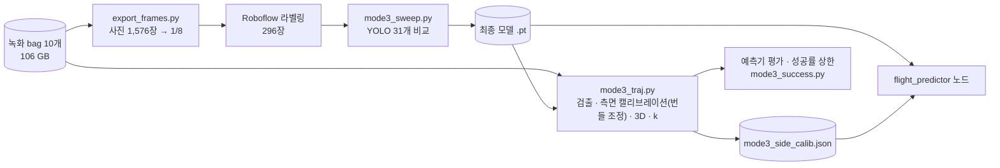

# 모드 3 (던진 공 패드로 받기) — 구조와 진행 현황

작성 박성현 · 2026-10-11 · 모드 3 담당. 팀원이 처음 읽는 문서. 실험 세부는 `MODE3_BRIEF.md`·`MODE3_RESULTS.md`(PR #107).

## 1. 한눈에

- **무엇**: 환자가 약 3 m 에서 던진 벨크로 공(지름 63.4 mm, 73.5 g)을 로봇이 패드(벨크로 지름 15 cm)로 받는다.
- **어떻게**: 카메라 2대로 공을 찾고 3D 로 추적 → 공기 저항을 넣은 칼만 필터로 "패드 면 어디에 언제 닿을지" 예측 → 로봇이 그 지점으로 패드를 옮긴다(amovel).
- **어디까지**: 인식·3D·예측은 **ROS 노드까지 완성**(bag 재생으로 검증). 로봇이 움직이는 **받기 스킬(`catch_ball`)은 구현·가짜 로봇(`--fake`)으로 흐름 확인**, 판정 뒤 로직은 정정인 담당 자리(`catch_ball.py` 의 `after_catch()`)만 있음. 실로봇 받기 시험은 아직 없다.

| 단계 | 상태 |
|---|---|
| 카메라 세팅·녹화 (투구 60회) | ✅ 10/10 |
| YOLO 공 검출 모델 | ✅ 31개 비교, 최종 yolo11n-seg 1024 |
| 측면 카메라 캘리브레이션·두 카메라 시각 차 | ✅ |
| 3D 궤적·공기 저항·예측기(EKF) | ✅ 오프라인 검증 |
| 예측기 ROS 노드 `flight_predictor` | ✅ 구현·bag 재생 검증 (이 문서와 같은 PR) |
| 로봇 응답·대기 자세·충격·nudge 시험 | ✅ 10/10~10/11 (정정인) |
| 받기 스킬 `catch_ball` (amovel 요격) | ✅ 구현·fake 확인 (같은 PR) · 판정 뒤 로직 ⬜ (정정인) |
| brain 에서 CatchBall 호출 | ⬜ 없음 |
| 실로봇 받기 시험(기준선) | ⬜ |
| Isaac 시뮬·강화학습 | ⬜ 다음 단계 (기간 뒤 가능성) |

## 2. 구조

```mermaid
flowchart LR
  subgraph CAM["카메라 (로봇·인식 PC)"]
    W["손목 RealSense D435i<br/>컬러 848×480 @60"]
    S["측면 RealSense D435i<br/>J1 기준 (0.74, −2.50, 0.85) m"]
  end

  subgraph FP["rally_vision / flight_predictor (컨테이너 pc2)"]
    Y["YOLO velcro_ball<br/>두 장 묶음 · TensorRT"]
    T["삼각측량<br/>측면 시각에 손목 픽셀 보간"]
    G["투구 시작 판정<br/>로봇 쪽 1.5 m/s↑ · 출발 x ≥ 1.2 m"]
    K["EKF<br/>중력 + 공기 저항 k"]
    X["패드 면 교차점·시각"]
    Y --> T --> G --> K --> X
  end

  W -- "/camera/color/image_raw" --> Y
  S -- "/side/side/color/image_raw" --> Y
  TF["tf base_link←link_6<br/>또는 /rally/robot/tcp_pose"] -. 손목 카메라 자세 .-> T
  CAL[("mode3_side_calib.json<br/>측면 자세·시각 차·k")] -. .-> T

  X -- "/rally/perception/landing<br/>/rally/perception/landing_info" --> CB

  subgraph RB["rally_robot (네이티브 pc1)"]
    CB["catch_ball 스킬<br/>amovel 요격 → 판정 → after_catch(정정인) → 복귀"]
    SM["safety_monitor<br/>힘 25 N · 작업 공간 · nudge"]
  end
  BR["rally_brain<br/>CatchBall 액션 ⬜"] -- goal --> CB
  CB -- "/rally/safety/contact_expected<br/>(받는 동안 nudge 끔)" --> SM
  CB -- DSR amovel --> R["M0609 + RG2 + 패드"]
```

오프라인(이 PC)에서 만든 것이 노드로 들어간다:



## 3. 한 번 던질 때의 순서와 시간

| 시각 (공 놓은 뒤) | 일 |
|---|---|
| 0 s | 공이 손을 떠남 (J1 에서 약 3 m, 바닥 0.8 m) |
| +0.02 s | 카메라 촬영 → 수신 지연 약 20 ms (10/10 실측) |
| +0.05~0.08 s | 3D 점 3개가 로봇 쪽으로 빠르게 오면 "투구 시작", 4개째부터 착지점 발행 (첫 예측 오차 2~5 cm) |
| +0.16 s | 예측 오차 중앙 약 3 cm → **이때 amovel 출발 명령** (계획) |
| +0.28 s | 로봇이 실제로 움직이기 시작 (명령 → 출발 115~148 ms, 실측) |
| +0.74 s | 공이 패드 면 도착 (비행 중앙값). 로봇이 갈 수 있는 거리는 약 18 cm |

- 프레임마다 예측을 갱신해 발행한다(60 Hz, 비행 중만). 시간이 지날수록 오차가 1 cm 아래로 준다.
- 성공 = 공이 벨크로(반지름 7.5 cm)에 닿음. 10/11 정지 시험에서 맞은 공 10번 중 9번 붙음.

## 4. 구성 요소

### 4.1 카메라
- 손목 D435i(140122076335) + 측면 D435i(147122075430). 컬러 848×480 60 fps, 노출 20 · gain 128 고정(번짐). 적외선 90 fps 는 공이 회색이라 안 씀.
- 측면 카메라는 위치를 바꾸면 **캘리브레이션을 다시** 해야 한다(현재 값은 10/10 위치).

### 4.2 YOLO (`ros2_ws/src/rally_vision/rally_vision/training/`)
- 10/10 녹화에서 사진을 뽑아 Roboflow `rally-wrj6t` v1(296장, 클래스 `velcro_ball`)로 라벨링.
- YOLOv8·YOLO11·YOLO26 × n/s × 입력 640·864·1024 + 증강 4종 + 시드 반복 = 31개 비교 → **yolo11n-seg, 입력 1024, 회전 증강**(시험 mask mAP50-95 평균 0.771). 라벨 사진 재현율 100 %, 배경 오검출 0.
- 로봇 PC(RTX 4060) TensorRT 두 장 묶음 13.2 ms(p95 15.5) → 60 fps 예산(16.7 ms) 안. 컨테이너에서 엔진 다시 만들어야 함.

### 4.3 3D 와 예측 (`flight_tracking.py`, `flight_predictor.py`)
- 손목 카메라 자세 = (tf base_link←link_6 × 플랜지→TCP) 또는 tcp_pose × `hand_eye.yaml`. 측면 카메라 자세는 `mode3_side_calib.json`(투구 궤적 번들 조정, 재투영 1.25 px).
- 두 카메라 시계 차 +15 ms 보정, 측면 시각에 손목 픽셀을 보간해 삼각측량, 재투영 6 px 넘으면 버림.
- 운동 모델: 가속도 = 중력 − k·|v|·v, **k = 0.073 /m**(실측. 공 크기로 계산한 값의 약 5배라 의문은 남지만 실제 궤적과 맞음. 공기 저항을 빼면 예측 오차가 40 cm).
- 패드 면: 중심 (0.327, −0.271, 0.531) m, 법선 45° 위(투구자 쪽). 교차점이 패드 중심 0.6 m 안일 때만 발행.

### 4.4 노드 `flight_predictor`

| | |
|---|---|
| 구독 | `/camera/color/image_raw`·`camera_info`(손목), `/side/side/color/image_raw`·`camera_info`(측면), `/rally/robot/tcp_pose`, tf |
| 발행 | `/rally/perception/landing` `PointStamped`(교차점, base_link, stamp = 마지막 관측 센서 시각) · **새** `/rally/perception/landing_info` `Float64MultiArray` [교차 시각, 남은 시간, 표준편차 u·w, 관측 수, 릴리스 후 시간] |
| 필요 파일 | `models/velcro_ball_yolo11n-seg_1024_rot_final.(engine\|pt)`, `models/mode3_side_calib.json` (git 제외, USB 로 전달) |
| 실행 | `ros2 run rally_vision flight_predictor` (측면 카메라는 BRIEF 7절 명령으로 따로 띄움 — pc2 launch 에 아직 없음) |
| 검증 | 단위 테스트 `test/test_flight_tracking.py`. 10/10 bag 재생: 잘못된 투구 시작 0건, 0.16 s 중앙 약 3 cm, 추론 13 ms |

`landing_info` 는 받기 스킬이 "언제 닿는지"를 알아야 해서 임시로 표준 메시지를 썼다. 전용 msg 로 바꿀지는 **조정묵 확인 필요**.

### 4.5 로봇 (정정인 10/10~10/11 실측)
- 대기 자세 posj [89.8, 30.0, −121.7, 90.2, −80.2, 88.3], 패드 면 45°, TCP → 패드 중심 공구 좌표 (−5.3, −4.8, +0.1) cm. 패드 + 손잡이 199 g, 브래킷을 38 N 으로 쥠.
- 20 cm 이동: 가속 1000 → 출발 148 ms · 도착 0.85 s / 가속 2000 → 115 ms · 0.61 s(50 N STOP).
- 이 자세는 **왼쪽(+y)으로 15 cm 넘게 가면 어깨 특이점**, 위아래는 약 0.6 m/s 가 한계.
- 공이 맞을 때마다 **nudge STOP**(힘 변화 5 N/20 ms). 최대 힘 15.4 N 이라 25 N 한계는 안 넘음.

### 4.6 받기 스킬 `catch_ball` (rally_robot)

| 단계 | 내용 |
|---|---|
| ready | 패드 쥐기 확인(`gripper.pad` 38 N) → 대기 자세 `mode3.ready_posj` 로 관절 이동 → 힘 영점 |
| tracking | 이 goal 뒤 첫 예측이 오면 투구 시작, `contact_expected` ON (받기 창 열림). 공 놓은 뒤 0.16 s 까지 최신 예측 대기 |
| intercept | 예측점 − 대기 패드 중심을 패드 면 두 축으로 나눠 왼쪽은 0, 오른쪽 ≤ 15 cm, 위아래 ±15 cm 로 잘라 TCP 를 그만큼 amovel (자세 그대로, 450 mm/s · 1000 mm/s²). catch_radius 밖이면 안 움직임 |
| judge | 도착 뒤 ~ 교차 시각 + 0.3 s 의 툴 힘 증가 ≥ 4 N 이면 명중. 붙음/튕김 구분은 비전 판정 생기면 |
| **after** | **`after_catch(node, goal_handle, ctx)` (catch_ball.py 안, 요격 코드와 떨어진 함수) — 정정인 담당**. ctx: 명중 여부·힘·대기 posj·요격 위치·예측점·설정. `ctx.skip_return = True` 면 복귀 생략 |
| return | 대기 자세 TCP 로 복귀 → succeed (caught 참/거짓). 안전·타임아웃·예외는 abort, `contact_expected` 는 finally 에서 끔 |

- 의존성: `catch_ball` 은 비전 코드를 import 하지 않는다(토픽만). 계산은 `catch_plan.py`(numpy·scipy). 정정인 로직은 같은 파일의 `after_catch()` 함수 안만 고치면 되고, 요격 코드와 떨어진 자리라 git 이 자동 병합한다(같은 줄을 둘이 고치지 않는 한).
- 확인: `test/test_catch_plan.py` 7개 통과. `skill_server --fake` + 가짜 안전 상태·예측 발행으로 ready → tracking → intercept(오른쪽 8 cm, 놓은 뒤 0.17 s) → 판정 → 복귀 흐름 확인. 실로봇은 아직.

## 5. 정한 규칙 (10/11)

1. TCP 자세는 고정, 위치만 움직인다(카메라·패드가 돌지 않게).
2. **왼쪽으로는 잡으러 가지 않는다.** 패드 왼쪽 끝 밖으로 온 공은 "환자 투구 실패"로 로봇 성공률 분모에서 뺀다. 판정은 측면 카메라의 실제 궤적으로 사후에. 보고는 유효 투구 성공률 · 전체 성공률 · 왼쪽 투구 비율 세 개를 같이.
3. 이동은 오른쪽·위·아래 약 15 cm. 현재 `safety.yaml` 작업 공간 그대로(모드 3 전용 작업 공간·힘 한계는 필요하면 정정인·팀 합의 후).
4. 기준선은 **amovel 만**. 예측이 3 cm 넘게 바뀌면 한 번 다시 보내는 ③ 은 구현돼 있으나 기본 꺼짐(`resend_enabled`, #130 속도 초과 확인 뒤). servol 보정은 나중.
5. 받기 창(투구 감지 ~ 교차 + 0.5 s, `contact_window_after_cross_s`) 동안만 `contact_expected` 를 켜서 nudge 를 끈다. 창이 닫히면 비전 판정(3 s)은 창 밖에서 기다린다. 25 N 힘 한계는 그대로 — 130 N 은 이 창에만 걸 예정 (#144, 10/12 창 닫기 구현).
6. 실시간 추론은 TensorRT.

## 6. 수치 요약 (10/10 투구 61회, 최종 모델)

| 항목 | 값 |
|---|---|
| 패드 면까지 비행 | 0.745 s (p10 0.69 · p90 0.84) |
| 출발 속도 · 발사각 | 약 7.3 m/s · 48.7° |
| 흩어짐 (패드 면 안 1σ) | 가로 21 cm · 세로 22 cm |
| 예측 오차 (측면 실측 기준) | 0.16 s 중앙 3.9 cm · 0.20 s 2.5 cm |
| 성공률 상한 (가속 2000) | 43~44 % (흩어짐 절반이면 약 77 %) |

- 상한에는 벨크로 부착률·검출 실패·힘 STOP 이 빠져 있다.
- **주의**: 10/10 투구는 지금 패드 위치를 겨냥한 것이 아니다(평균이 패드 중심에서 약 51 cm). 상한은 "대기 위치를 투구 평균에 둔다"는 가정의 값이다.
- 가장 큰 개선 여지는 **던지는 사람의 일관성**.

## 7. 남은 일과 담당 (제안)

| 할 일 | 제안 담당 | 필요한 것 |
|---|---|---|
| `flight_predictor` PR (`landing_info` 인터페이스 포함) | 박성현 | 조정묵 인터페이스 리뷰 |
| `catch_ball` 요격 (구현됨) 리뷰 + 실로봇 확인 | 정정인 리뷰 | 안전 변경 없음, `contact_expected` 는 비행 중만 |
| **판정 뒤 로직** `skills/catch_ball.py` 의 `after_catch()` | **정정인** | 이 함수 안만 고치면 됨 (위 4.6) |
| `skills.yaml` `max_ball_speed_mps` 3.0 → 실측 약 7.3 (지금 쓰는 코드 없음) | 정정인·박성현 | 대기 자세·패드 그립(38 N)·요격 값은 10/11 추가함 |
| brain 에서 CatchBall 호출(세션 흐름) | 조정묵 | 액션은 이미 정의됨 |
| pc2 launch 에 측면 RealSense 추가 | 조정묵·박성현 | 시리얼 147122075430 |
| 컨테이너에서 TensorRT 엔진 생성 + 실영상 전체 지연 | 정정인 PC | 모델·캘리브레이션 파일 |
| 실로봇 기준선 받기 시험 (10~20회, 붙음/튕김·STOP 기록) | 박성현 + 정정인 | 위 항목들 |
| Isaac 트윈·강화학습 | 박성현 | 기준선 결과 (기간 뒤 가능성) |

## 8. 파일

| 파일 | 내용 |
|---|---|
| `ros2_ws/src/rally_vision/rally_vision/flight_predictor_node.py` | ROS 노드 |
| `ros2_ws/src/rally_vision/rally_vision/flight_tracking.py` | 삼각측량·투구 판정 (ROS 없음) |
| `ros2_ws/src/rally_vision/rally_vision/flight_predictor.py` | EKF 예측기 |
| `ros2_ws/src/rally_vision/rally_vision/training/mode3_sweep.py`, `mode3_eval.py` | YOLO 비교·평가 (박성현 PC, 다음 PR) |
| `scripts/catch_lab/export_frames.py`, `mode3_traj.py`, `mode3_success.py` | 사진 추출 · 캘리브레이션·3D·예측 평가 · 성공률 상한 (박성현 PC, 다음 PR) |
| `scripts/mode3_reach_test.py`, `scripts/catch_lab/robotpc_yolo_bench.sh` | 로봇 응답 시험 · 추론 지연 시험 (PR #107) |
| `ros2_ws/src/rally_robot/rally_robot/skills/catch_ball.py` | 받기 스킬 (요격·판정·복귀) + `after_catch()` (정정인) |
| `ros2_ws/src/rally_robot/rally_robot/skills/catch_plan.py` | 요격 위치·명중 판정 계산 (ROS 없음, `test/test_catch_plan.py`) |
| `docs/mode3/MODE3_BRIEF.md`·`TODO`·`RESULTS` | 실험 계획·기록 (PR #107) |
